# Main text figures

Below, I describe how I generated the figures used in the main text of the paper.
The figures that appear in the paper have all been altered slightly compared to the images shown below to add annotations like sub-plot identifiers and to reduce whitespace.
For details on how each of the plotting functions used were developed, see the Analysis guides. 

## Contents

- [Preparation](#preparation)
- [Figures of climatology maps](#figures-of-climatology-maps)
    - [Figure 1](#figure-1)
    - [Figure 2](#figure-2)
- [Figures of trend maps](#figures-of-trend-maps)
    - [Figure 3](#figure-3)
    - [Figure 4](#figure-4)
    - [Figure 5](#figure-5)
    - [Figure 6](#figure-6)
- [Figures of monthly time series for specific regions](#figures-of-monthly-time-series-for-specific-regions)
    - [Figure 7: QEI West](#figure-7-qei-west)
- [Figures of trends in specific regions](#figures-of-trends-in-specific-regions)
    - [Figure 8: QEI West](#figure-8-qei-west)
    - [Figure 9: Parry Channel](#figure-9-parry-channel)
    - [Figure 10: Nares Strait](#figure-10-nares-strait)

---

## Preparation
[back to top](#main-text-figures)

Most of the plots below rely on interpolating onto a pre-existing target grid file. 
If not previously generated, it is necessary to make such a file using my `make_example_latlon_grid()` function to be a $0.25\times0.25$ degree grid.
```python
from arctichoke.dataset import make_example_latlon_grid

target_grid = make_example_latlon_grid(
    save_as = 'data/target_grid_0-25_deg.nc',
    lat_step = 0.25,
    lon_step = 0.25,
)
print(target_grid)
```
```console
<xarray.Dataset> Size: 8MB
Dimensions:   (lat: 721, lon: 1441)
Coordinates:
  * lat       (lat) float64 6kB -90.0 -89.75 -89.5 -89.25 ... 89.5 89.75 90.0
  * lon       (lon) float64 12kB -180.0 -179.8 -179.5 ... 179.5 179.8 180.0
Data variables:
    test_var  (lat, lon) float64 8MB 0.0 1.0 2.0 ... 1.039e+06 1.039e+06
Attributes:
    grid:     N216
```

---

## Figures of climatology maps
[back to top](#main-text-figures)

### Figure 1
[back to top](#main-text-figures)

This figure will include subplots of climatologies (1950-1969) of sea ice thickness, speed, concentration, and concentration where sea ice thickness is greater than 2 meters for variant 1, `r1i1p2f1`, of `EC-Earth3P-HR`.
The code below takes about a minute to run on my laptop.
```python
from matplotlib import pyplot as plt
import xarray as xr

from arctichoke.dataset import select_months
from arctichoke.dataset.clim_mask import make_clim_mask
from arctichoke.dataset.interp_dataset import interp_to_reg_grid
from arctichoke.path import list_variable_files
import arctichoke.params as sps
from arctichoke.params import sea_ice_vars
from arctichoke.plot import plot_map
from arctichoke.plot.labels_and_titles import make_title
from arctichoke.plot.stippling import add_hatches

# Set up Figure
plt.rcParams["figure.figsize"] = [18, 18]
rows = 2
cols = 2
fig, axs = plt.subplots(rows, cols, squeeze=False)
axis_titles = []

this_model = 'EC-Earth3P-HR'
this_experiment = 'hist-1950'
this_modification = 'trim_CAA_'
set_verbose = False

for variant_label in [
    'r1i1p2f1', 
    # 'r2i1p2f1', 
    # 'r3i1p2f1',
]:
    # Create the sea ice mask
    clim_mask_dataset = make_clim_mask(
        this_source_id = this_model,
        this_experiment = this_experiment,
        this_var = 'siconc',
        this_variant_label = variant_label,
        this_modification = this_modification,
        verbose = set_verbose
    )
    i = 0
    for this_si_var in [
        'sithick',
        'sispeed',
        'siconc',
        'siconc_si2mthick',
    ]:
        # Get the relevant file path
        sivar_clim_file = list_variable_files(
            source_id = this_model,
            variable_id = f'{this_si_var}_month_mean',
            experiment_id = this_experiment,
            variant_label = variant_label,
            with_modification = this_modification,
            verbose = set_verbose,
        )
        # Select just the summer months
        dataset_clim = select_months(sivar_clim_file, time_dim='month')
        # Determine whether this is a regular or marker variable
        if this_si_var in sea_ice_vars.keys():
            if sea_ice_vars[this_si_var]['marker_var']:
                # Take the sum across the 12 months
                dataset_clim = dataset_clim.sum(dim='month', min_count=1)
            else:
                # Take the mean across the 12 months
                dataset_clim = dataset_clim.mean(dim='month')
        else:
            raise ValueError(f"(Plotting climatologies) `this_si_var={this_si_var}` is not in the `sea_ice_vars` dictionary. Available variables: {sea_ice_vars.keys()}")
        # Copy the variable attributes
        keep_these_attrs = dataset_clim[f'{this_si_var}_month_mean'].attrs
        # Apply the sea ice mask
        dataset_clim[f'{this_si_var}_month_mean'] = dataset_clim[f'{this_si_var}_month_mean'] * clim_mask_dataset['siconc_clim_mask']
        # Put the variable attributes back
        dataset_clim[f'{this_si_var}_month_mean'].attrs = keep_these_attrs
        # Adjust the `long_name` attribute to change the colorbar label
        dataset_clim[f'{this_si_var}_month_mean'].attrs['long_name'] = dataset_clim[f'{this_si_var}_month_mean'].attrs['long_name'].replace('onthly m', '')
        # Interpolate the data
        dataset_interp = interp_to_reg_grid(
            dataset = dataset_clim,
            targetgrid = 'data/target_grid_0-25_deg.nc',
            trim_to_bbox = sps.CAA_BBOX,
            verbose = set_verbose,
        )

        # Get the title for this axis
        axis_titles.append(make_title(dataset_interp))
        # Select the correct axis
        this_row = i//cols
        this_col = i%cols
        this_ax = axs[this_row, this_col]
        # Plot the data on a map
        plot_axis = plot_map(
            dataset_interp,
            f'{this_si_var}_month_mean',
            clims = sea_ice_vars[this_si_var]['plot_range'],
            map_title = '',
            fig = fig,
            axis = this_ax,
            use_hvplot = False,
            zoom_out_bbox = False,
            verbose = set_verbose,
        )
        # Add hatch marks, if applicable
        if 'siconc' in this_si_var:
            add_hatch = True
            hatch_label = '>85%'
            hatch_levels = [85, 100]
            mark_levels = [False, True]
            hatch_style = '/'
            hatch_density = 4
            hatch_color = sps.hatch_red
            contour_level = 85
        elif 'sispeed' in this_si_var:
            add_hatch = True
            hatch_label = '<1 cm/s'
            hatch_levels = [0, 0.01]
            mark_levels = [True, False]
            hatch_style = '.'
            hatch_density = 7
            hatch_color = sps.hatch_red
            contour_level = 0.01
        else: 
            add_hatch = False
        if add_hatch:
            # Add hatch lines
            handles = add_hatches(
                plot_axis, 
                dataset_interp,
                f'{this_si_var}_month_mean',
                hatch_label,
                hatch_levels = hatch_levels,
                mark_levels = mark_levels,
                hatch_style = hatch_style,
                hatch_density = hatch_density,
                hatch_color = hatch_color,
                contour_level = contour_level,
                verbose = set_verbose,
            )

            # Add label for the hatches in the legend
            plot_axis.legend(handles=handles, loc='upper right')
        i += 1
# Check whether the axis titles are unique
if len(set(axis_titles)) == 1:
    fig.suptitle(axis_titles[0])

# Save the plot to file
plt.savefig('docs/docs_results/main_figures-img/Figure_1.png', dpi=200, bbox_inches='tight')

plt.show()
```
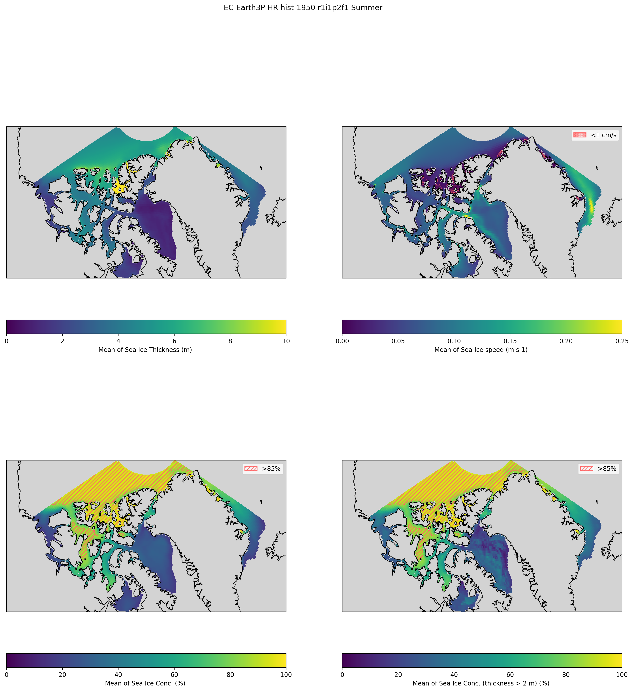

### Figure 2
[back to top](#main-text-figures)

This figure will include subplots of climatologies (1950-1969) of slow ice, packed ice, and landfast ice for variant 1, `r1i1p2f1`, of `EC-Earth3P-HR`. 
The code below takes about 30 seconds to run on my laptop.
```python
import cartopy.crs as crs
from matplotlib import pyplot as plt
import numpy as np
import pandas as pd
import xarray as xr

from arctichoke.dataset import select_months
from arctichoke.dataset.clim_mask import make_clim_mask
from arctichoke.dataset.interp_dataset import interp_to_reg_grid
from arctichoke.path import list_variable_files
import arctichoke.params as sps
from arctichoke.params import sea_ice_vars
from arctichoke.plot import plot_map
from arctichoke.plot.labels_and_titles import make_title
from arctichoke.plot.stippling import add_hatches

# Set up Figure
plt.rcParams["figure.figsize"] = [18, 18]
rows = 2
cols = 2
fig, axs = plt.subplots(rows, cols, squeeze=False)

this_model = 'EC-Earth3P-HR'
this_experiment = 'hist-1950'
this_modification = 'trim_CAA_'
set_verbose = False

for variant_label in [
    'r1i1p2f1', 
    # 'r2i1p2f1', 
    # 'r3i1p2f1',
]:
    # Create the sea ice mask
    clim_mask_dataset = make_clim_mask(
        this_source_id = this_model,
        this_experiment = this_experiment,
        this_var = 'siconc',
        this_variant_label = variant_label,
        this_modification = this_modification,
        verbose = set_verbose
    )
    i = 0
    for this_si_var in [
        'sislow',
        'sipacked',
        'silandfast',
    ]:
        print(f'Now plotting {this_si_var}')
        # Get the relevant file path
        sivar_clim_file = list_variable_files(
            source_id = this_model,
            variable_id = f'{this_si_var}_month_mean',
            experiment_id = this_experiment,
            variant_label = variant_label,
            with_modification = this_modification,
            verbose = set_verbose,
        )
        # Select just the summer months
        dataset_clim = select_months(sivar_clim_file, time_dim='month')
        # Determine whether this is a regular or marker variable
        if this_si_var in sea_ice_vars.keys():
            if sea_ice_vars[this_si_var]['marker_var']:
                # Take the sum across the 12 months
                dataset_clim = dataset_clim.sum(dim='month', min_count=1)
            else:
                # Take the mean across the 12 months
                dataset_clim = dataset_clim.mean(dim='month')
        else:
            raise ValueError(f"(Plotting climatologies) `this_si_var={this_si_var}` is not in the `sea_ice_vars` dictionary. Available variables: {sea_ice_vars.keys()}")
        # Copy the variable attributes
        keep_these_attrs = dataset_clim[f'{this_si_var}_month_mean'].attrs
        # Apply the sea ice mask
        dataset_clim[f'{this_si_var}_month_mean'] = dataset_clim[f'{this_si_var}_month_mean'] * clim_mask_dataset['siconc_clim_mask']
        # Put the variable attributes back
        dataset_clim[f'{this_si_var}_month_mean'].attrs = keep_these_attrs
        # Adjust the `long_name` attribute to change the colorbar label
        dataset_clim[f'{this_si_var}_month_mean'].attrs['long_name'] = dataset_clim[f'{this_si_var}_month_mean'].attrs['long_name'].replace('onthly m', '')
        # Interpolate the data
        dataset_interp = interp_to_reg_grid(
            dataset = dataset_clim,
            targetgrid = 'data/target_grid_0-25_deg.nc',
            trim_to_bbox = sps.CAA_BBOX,
            verbose = set_verbose,
        )

        # Select the correct axis
        this_row = i//cols
        this_col = i%cols
        this_ax = axs[this_row, this_col]
        # Plot the data on a map
        plot_axis = plot_map(
            dataset_interp,
            f'{this_si_var}_month_mean',
            clims = sea_ice_vars[this_si_var]['plot_range'],
            fig = fig,
            axis = this_ax,
            use_hvplot = False,
            zoom_out_bbox = False,
            verbose = set_verbose,
        )
        i += 1
    # Add bounding boxes to the map of landfast ice
    landfast_bboxes = [
        {
            'bbox': sps.NS_BBOX,
            'bbox_clr': 'k',
        },
        {
            'bbox': sps.PC_BBOX,
            'bbox_clr': 'w',
        },
        {
            'bbox': sps.QW_BBOX,
            'bbox_clr': 'r',
        },
    ]
    j = 3
    for j in range(len(landfast_bboxes)):
        mark_bbox = landfast_bboxes[j]['bbox']
        # Set the number of points per side of the frame of the bounding box
        n = 25
        frame_df = pd.DataFrame({
            'lon': np.concatenate([
                np.linspace(mark_bbox[3], mark_bbox[2], n),
                [mark_bbox[2]]*(n-1), 
                np.linspace(mark_bbox[2], mark_bbox[3], n),
                [mark_bbox[3]]*(n-1), 
            ]),
            'lat': np.concatenate([
                [mark_bbox[1]]*(n-1), 
                np.linspace(mark_bbox[1], mark_bbox[0], n),
                [mark_bbox[0]]*(n-1), 
                np.linspace(mark_bbox[0], mark_bbox[1], n),
            ]),
        })
        # Add bounding box frame
        plot_axis.plot(frame_df['lon'], frame_df['lat'], color=landfast_bboxes[j]['bbox_clr'], linestyle='-', linewidth=1, transform=crs.PlateCarree())
        j += 1
    
# Remove unused axis
axs[1,1].remove()

# Save the plot to file
plt.savefig('docs/docs_results/main_figures-img/Figure_2.png', dpi=200, bbox_inches='tight')

plt.show()
```
```console
Now plotting sislow
Now plotting sipacked
Now plotting silandfast
```
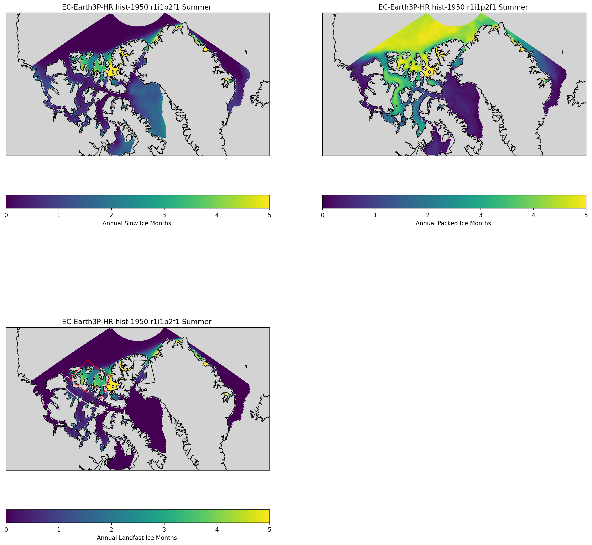

---

## Figures of trend maps
[back to top](#main-text-figures)

### Figure 3
[back to top](#main-text-figures)

This figure will include subplots of trend maps (1950-2014) of sea ice thickness, speed, concentration, and concentration where sea ice thickness is greater than 2 meters for variant 1, `r1i1p2f1`, of `EC-Earth3P-HR`.
The code below takes about three minutes to run on my laptop.
```python
from matplotlib import pyplot as plt
import numpy as np
import xarray as xr

from arctichoke.analysis import sum_by_year 
from arctichoke.dataset import make_mask, select_months
from arctichoke.dataset.clim_mask import make_clim_mask
import arctichoke.params as sps
from arctichoke.params import sea_ice_vars
from arctichoke.path import list_variable_files
from arctichoke.plot import make_trend_map

# Set up Figure
plt.rcParams["figure.figsize"] = [18, 18]
rows = 2
cols = 2
fig, axs = plt.subplots(rows, cols, squeeze=False)
axis_titles = []

this_model = 'EC-Earth3P-HR'
this_experiment = 'hist-1950'
this_modification = 'trim_CAA_'
set_summer = True
set_verbose = False

for variant_label in [
    'r1i1p2f1',
    # 'r2i1p2f1',
    # 'r3i1p2f1',
]:
    # Create the sea ice mask
    clim_mask_dataset = make_clim_mask(
        this_source_id = this_model,
        this_experiment = this_experiment,
        this_var = 'siconc',
        this_variant_label = variant_label,
        this_modification = this_modification,
        verbose = set_verbose
    )
    i = 0
    for variable_id in [
        'sithick',
        'sispeed',
        'siconc',
        'si2mthick'
    ]:
        print(f'Now plotting {variable_id}')
        # Select the correct axis
        this_row = i//cols
        this_col = i%cols
        this_ax = axs[this_row, this_col]
        # Check whether to mask to just where ice is greater than 2 meters
        if variable_id == 'si2mthick':
            ## Make a mask based on summer average sea ice thickness
            # Get the files
            sithick_filelist = list_variable_files(
                source_id = this_model,
                variable_id = 'sithick',
                variant_label = variant_label,
                with_modification = this_modification,
                verbose = set_verbose,
            )
            if set_summer:
                # Select just the summer months
                sithick_dataset = select_months(
                    sithick_filelist,
                    verbose = set_verbose,
                )
            else:
                sithick_dataset = xr.open_mfdataset(sithick_filelist)
            # Take the yearly average
            sithick_dataset = sum_by_year(
                sithick_dataset,
                find_mean = True,
                verbose = set_verbose,
            )
            # Get the maximum possible integer to cover all reasonable values of `sithick`
            numpy_int32_max = np.iinfo(np.int32).max
            # Make the mask of sea ice thicker than 2 meters
            si2mthick_var = 'si2mthick_year_mean'
            sithick_dataset = make_mask(
                sithick_dataset,
                var = 'sithick_year_mean',
                mask_var_name = si2mthick_var,
                mask_this_range = [2, numpy_int32_max],
                val_inside_range = 1,
                val_outside_range = 0,
                add_mask_attrs = True,
                verbose = set_verbose,
            )
            # Copy the variable attributes
            keep_these_attrs = sithick_dataset[si2mthick_var].attrs
            # Apply the sea ice mask
            sithick_dataset[si2mthick_var] = sithick_dataset[si2mthick_var] * clim_mask_dataset['siconc_clim_mask']
            # Put the variable attributes back
            sithick_dataset[si2mthick_var].attrs = keep_these_attrs
            # Find the sum of the years of sea ice over 2 meters thick
            sithick_dataset_sum = sithick_dataset.sum(dim='year', min_count=1)
            sithick_dataset_sum[si2mthick_var].attrs['long_name'] = "Number of years with sea ice thickness > 2 m"
            sithick_dataset_sum[si2mthick_var].attrs['units'] = "yr"
            # Reset the variables to use in `make_trend_map`
            variable_id = 'siconc'
            use_this_mask = sithick_dataset[si2mthick_var]
            this_map_label = 'Trend in Yearly mean Conc. (thickness > 2 m) (%/yr)'
        else:
            use_this_mask = clim_mask_dataset['siconc_clim_mask']
            this_map_label = None
        # Plot the trend map
        this_map = make_trend_map(
            this_source_id = this_model,
            this_var = variable_id,
            this_variant_label = variant_label, 
            this_modification = this_modification,
            mask_where_zero_across_time = use_this_mask,
            select_summer = set_summer,
            call_sum_by_year = True,
            use_hvplot = False,
            trim_to_bbox = sps.CAA_BBOX,
            zoom_out_bbox = False,
            fig = fig,
            axis = this_ax,
            time_dim = 'time',
            find_mean = True,
            clims = sea_ice_vars[variable_id]['trend_clims'],
            return_map = True,
            map_label = this_map_label,
            verbose = set_verbose,
        )
        i += 1

# Save the plot to file
plt.savefig('docs/docs_results/main_figures-img/Figure_3.png', dpi=200, bbox_inches='tight')

plt.show()
```
```console
Now plotting sithick
Now plotting sispeed
Now plotting siconc
Now plotting si2mthick
```
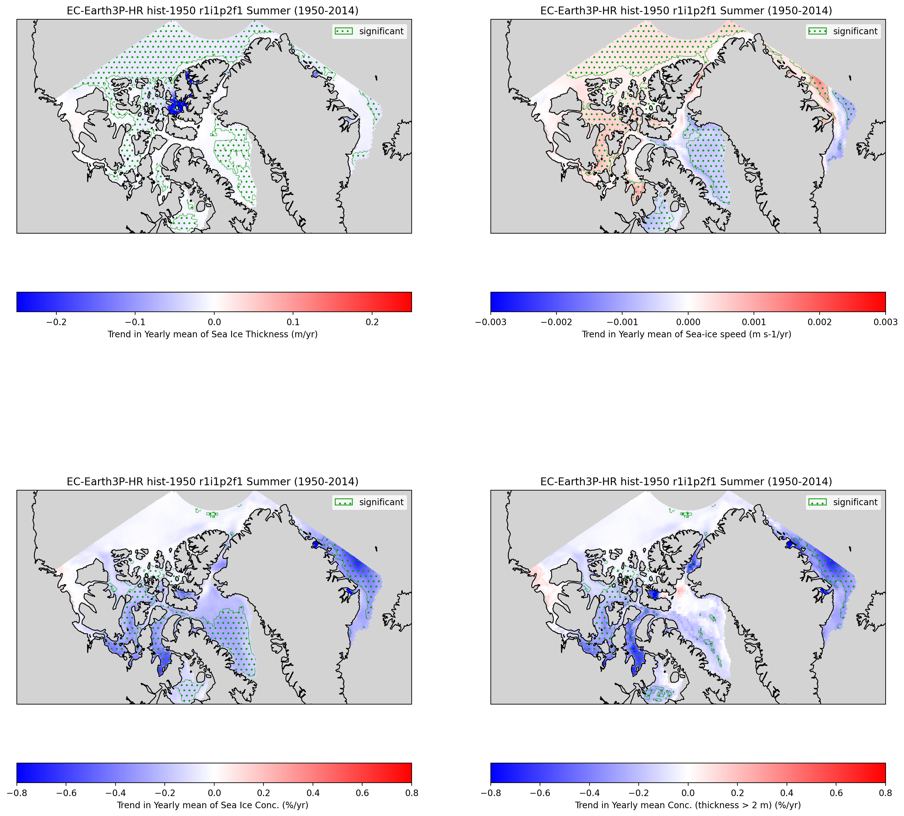

### Figure 4
[back to top](#main-text-figures)

This figure will include subplots of trend maps (1950-2014) of slow ice, packed ice, landfast ice, landfast ice using the climatology of slow ice, and landfast ice using the climatology of packed ice for variant 1, `r1i1p2f1`, for `EC-Earth3P-HR`.
The code below takes about four minutes to run on my laptop.
```python
from matplotlib import pyplot as plt
import numpy as np
import xarray as xr

from arctichoke.analysis import sum_by_year 
from arctichoke.dataset import make_mask, select_months
from arctichoke.dataset.clim_mask import make_clim_mask
import arctichoke.params as sps
from arctichoke.params import sea_ice_vars
from arctichoke.path import list_variable_files
from arctichoke.plot import make_trend_map

# Set up Figure
plt.rcParams["figure.figsize"] = [18, 24]
rows = 3
cols = 2
fig, axs = plt.subplots(rows, cols, squeeze=False)
axis_titles = []

this_model = 'EC-Earth3P-HR'
this_experiment = 'hist-1950'
this_modification = 'trim_CAA_'
set_verbose = False

for variant_label in [
    'r1i1p2f1',
    # 'r2i1p2f1',
    # 'r3i1p2f1',
]:
    # Create the sea ice mask
    clim_mask_dataset = make_clim_mask(
        this_source_id = this_model,
        this_experiment = this_experiment,
        this_var = 'siconc',
        this_variant_label = variant_label,
        this_modification = this_modification,
        verbose = set_verbose
    )
    i = 0
    for variable_id in [
        'sislow',
        'sipacked',
    ]:
        print(f'Now plotting {variable_id}')
        # Select the correct axis
        this_row = i//cols
        this_col = i%cols
        this_ax = axs[this_row, this_col]
        # Plot the trend map
        this_map = make_trend_map(
            this_source_id = this_model,
            this_var = variable_id,
            this_variant_label = variant_label,
            this_modification = 'trim_CAA_',
            mask_where_zero_across_time = clim_mask_dataset['siconc_clim_mask'],
            select_summer = True,
            use_hvplot = False,
            zoom_out_bbox = False,
            trim_to_bbox = sps.CAA_BBOX,
            fig = fig,
            axis = this_ax,
            contour_level = 0.5,
            clims = sea_ice_vars[variable_id]['trend_clims'],
            return_map = True,
            verbose = set_verbose,
        )
        i += 1
    # Remove the unneeded axis
    # Select the correct axis
    this_row = i//cols
    this_col = i%cols
    axs[this_row, this_col].remove()
    i += 1
    for this_version_id in [
        'v20260617',
        'with_siconc_clim',
        'with_sispeed_clim',
    ]:
        print(f'Now plotting silandfast for {this_version_id}')
        # Select the correct axis
        this_row = i//cols
        this_col = i%cols
        this_ax = axs[this_row, this_col]
        # Plot the trend map
        this_map = make_trend_map(
            this_source_id = this_model,
            this_var = 'silandfast',
            this_variant_label = variant_label,
            this_modification = 'trim_CAA_',
            mask_where_zero_across_time = True,
            version_id = this_version_id,
            select_summer = True,
            use_hvplot = False,
            zoom_out_bbox = False,
            trim_to_bbox = sps.CAA_BBOX,
            fig = fig,
            axis = this_ax,
            clims = sea_ice_vars['silandfast']['trend_clims'],
            add_sig = True,
            return_map = True,
            verbose = set_verbose,
        )
        i += 1

# Save the plot to file
plt.savefig('docs/docs_results/main_figures-img/Figure_4.png', dpi=200, bbox_inches='tight')

plt.show()
```
```console
Now plotting sislow
Now plotting sipacked
Now plotting silandfast for v20260617
Now plotting silandfast for with_siconc_clim
Now plotting silandfast for with_sispeed_clim
```
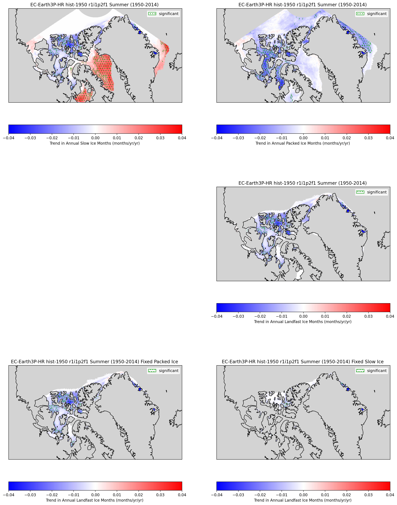

### Figure 5
[back to top](#main-text-figures)

This figure will include subplots of trend maps (1950-2014) of sea ice thickness, speed, concentration, and concentration where sea ice thickness is greater than 2 meters for variant 2, `r2i1p2f1`, of `EC-Earth3P-HR`.
The code below takes about three minutes to run on my laptop.
```python
from matplotlib import pyplot as plt
import numpy as np
import xarray as xr

from arctichoke.analysis import sum_by_year 
from arctichoke.dataset import make_mask, select_months
from arctichoke.dataset.clim_mask import make_clim_mask
import arctichoke.params as sps
from arctichoke.params import sea_ice_vars
from arctichoke.path import list_variable_files
from arctichoke.plot import make_trend_map

# Set up Figure
plt.rcParams["figure.figsize"] = [18, 18]
rows = 2
cols = 2
fig, axs = plt.subplots(rows, cols, squeeze=False)
axis_titles = []

this_model = 'EC-Earth3P-HR'
this_experiment = 'hist-1950'
this_modification = 'trim_CAA_'
set_summer = True
set_verbose = False

for variant_label in [
    # 'r1i1p2f1',
    'r2i1p2f1',
    # 'r3i1p2f1',
]:
    # Create the sea ice mask
    clim_mask_dataset = make_clim_mask(
        this_source_id = this_model,
        this_experiment = this_experiment,
        this_var = 'siconc',
        this_variant_label = variant_label,
        this_modification = this_modification,
        verbose = set_verbose
    )
    i = 0
    for variable_id in [
        'sithick',
        'sispeed',
        'siconc',
        'si2mthick'
    ]:
        print(f'Now plotting {variable_id}')
        # Select the correct axis
        this_row = i//cols
        this_col = i%cols
        this_ax = axs[this_row, this_col]
        # Check whether to mask to just where ice is greater than 2 meters
        if variable_id == 'si2mthick':
            ## Make a mask based on summer average sea ice thickness
            # Get the files
            sithick_filelist = list_variable_files(
                source_id = this_model,
                variable_id = 'sithick',
                variant_label = variant_label,
                with_modification = this_modification,
                verbose = set_verbose,
            )
            if set_summer:
                # Select just the summer months
                sithick_dataset = select_months(
                    sithick_filelist,
                    verbose = set_verbose,
                )
            else:
                sithick_dataset = xr.open_mfdataset(sithick_filelist)
            # Take the yearly average
            sithick_dataset = sum_by_year(
                sithick_dataset,
                find_mean = True,
                verbose = set_verbose,
            )
            # Get the maximum possible integer to cover all reasonable values of `sithick`
            numpy_int32_max = np.iinfo(np.int32).max
            # Make the mask of sea ice thicker than 2 meters
            si2mthick_var = 'si2mthick_year_mean'
            sithick_dataset = make_mask(
                sithick_dataset,
                var = 'sithick_year_mean',
                mask_var_name = si2mthick_var,
                mask_this_range = [2, numpy_int32_max],
                val_inside_range = 1,
                val_outside_range = 0,
                add_mask_attrs = True,
                verbose = set_verbose,
            )
            # Copy the variable attributes
            keep_these_attrs = sithick_dataset[si2mthick_var].attrs
            # Apply the sea ice mask
            sithick_dataset[si2mthick_var] = sithick_dataset[si2mthick_var] * clim_mask_dataset['siconc_clim_mask']
            # Put the variable attributes back
            sithick_dataset[si2mthick_var].attrs = keep_these_attrs
            # Find the sum of the years of sea ice over 2 meters thick
            sithick_dataset_sum = sithick_dataset.sum(dim='year', min_count=1)
            sithick_dataset_sum[si2mthick_var].attrs['long_name'] = "Number of years with sea ice thickness > 2 m"
            sithick_dataset_sum[si2mthick_var].attrs['units'] = "yr"
            # Reset the variables to use in `make_trend_map`
            variable_id = 'siconc'
            use_this_mask = sithick_dataset[si2mthick_var]
            this_map_label = 'Trend in Yearly mean Conc. (thickness > 2 m) (%/yr)'
        else:
            use_this_mask = clim_mask_dataset['siconc_clim_mask']
            this_map_label = None
        # Plot the trend map
        this_map = make_trend_map(
            this_source_id = this_model,
            this_var = variable_id,
            this_variant_label = variant_label, 
            this_modification = this_modification,
            mask_where_zero_across_time = use_this_mask,
            select_summer = set_summer,
            call_sum_by_year = True,
            use_hvplot = False,
            zoom_out_bbox = False,
            trim_to_bbox = sps.CAA_BBOX,
            fig = fig,
            axis = this_ax,
            time_dim = 'time',
            find_mean = True,
            clims = sea_ice_vars[variable_id]['trend_clims'],
            return_map = True,
            map_label = this_map_label,
            verbose = set_verbose,
        )
        i += 1

# Save the plot to file
plt.savefig('docs/docs_results/main_figures-img/Figure_5.png', dpi=200, bbox_inches='tight')

plt.show()
```
```console
Now plotting sithick
Now plotting sispeed
Now plotting siconc
Now plotting si2mthick
```
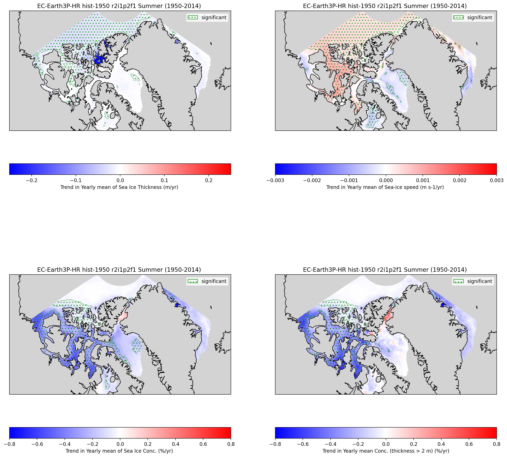

### Figure 6
[back to top](#main-text-figures)

This figure will include subplots of trend maps (1950-2014) of slow ice, packed ice, landfast ice, landfast ice using the climatology of slow ice, and landfast ice using the climatology of packed ice for variant 2, `r2i1p2f1`, of `EC-Earth3P-HR`.
The code below takes about three and a half minutes to run on my laptop.
```python
from matplotlib import pyplot as plt
import numpy as np
import xarray as xr

from arctichoke.analysis import sum_by_year 
from arctichoke.dataset import make_mask, select_months
from arctichoke.dataset.clim_mask import make_clim_mask
import arctichoke.params as sps
from arctichoke.params import sea_ice_vars
from arctichoke.path import list_variable_files
from arctichoke.plot import make_trend_map

# Set up Figure
plt.rcParams["figure.figsize"] = [18, 24]
rows = 3
cols = 2
fig, axs = plt.subplots(rows, cols, squeeze=False)
axis_titles = []

this_model = 'EC-Earth3P-HR'
this_experiment = 'hist-1950'
this_modification = 'trim_CAA_'
set_verbose = False

for variant_label in [
    # 'r1i1p2f1',
    'r2i1p2f1',
    # 'r3i1p2f1',
]:
    # Create the sea ice mask
    clim_mask_dataset = make_clim_mask(
        this_source_id = this_model,
        this_experiment = this_experiment,
        this_var = 'siconc',
        this_variant_label = variant_label,
        this_modification = this_modification,
        verbose = set_verbose
    )
    i = 0
    for variable_id in [
        'sislow',
        'sipacked',
    ]:
        print(f'Now plotting {variable_id}')
        # Select the correct axis
        this_row = i//cols
        this_col = i%cols
        this_ax = axs[this_row, this_col]
        # Plot the trend map
        this_map = make_trend_map(
            this_source_id = this_model,
            this_var = variable_id,
            this_variant_label = variant_label,
            this_modification = 'trim_CAA_',
            mask_where_zero_across_time = clim_mask_dataset['siconc_clim_mask'],
            select_summer = True,
            use_hvplot = False,
            zoom_out_bbox = False,
            trim_to_bbox = sps.CAA_BBOX,
            fig = fig,
            axis = this_ax,
            clims = sea_ice_vars[variable_id]['trend_clims'],
            return_map = True,
            verbose = set_verbose,
        )
        i += 1
    # Remove the unneeded axis
    # Select the correct axis
    this_row = i//cols
    this_col = i%cols
    axs[this_row, this_col].remove()
    i += 1
    for this_version_id in [
        'v20260617',
        'with_siconc_clim',
        'with_sispeed_clim',
    ]:
        print(f'Now plotting silandfast for {this_version_id}')
        # Select the correct axis
        this_row = i//cols
        this_col = i%cols
        this_ax = axs[this_row, this_col]
        # Set parameters
        add_stippling = True
        # Plot the trend map
        this_map = make_trend_map(
            this_source_id = this_model,
            this_var = 'silandfast',
            this_variant_label = variant_label,
            this_modification = 'trim_CAA_',
            mask_where_zero_across_time = True,
            version_id = this_version_id,
            select_summer = True,
            use_hvplot = False,
            zoom_out_bbox = False,
            trim_to_bbox = sps.CAA_BBOX,
            fig = fig,
            axis = this_ax,
            clims = sea_ice_vars['silandfast']['trend_clims'],
            add_sig = True,
            return_map = True,
            verbose = set_verbose,
        )
        i += 1

# Save the plot to file
plt.savefig('docs/docs_results/main_figures-img/Figure_6.png', dpi=200, bbox_inches='tight')

plt.show()
```
```console
Now plotting sislow
Now plotting sipacked
Now plotting silandfast for v20260617
Now plotting silandfast for with_siconc_clim
Now plotting silandfast for with_sispeed_clim
```
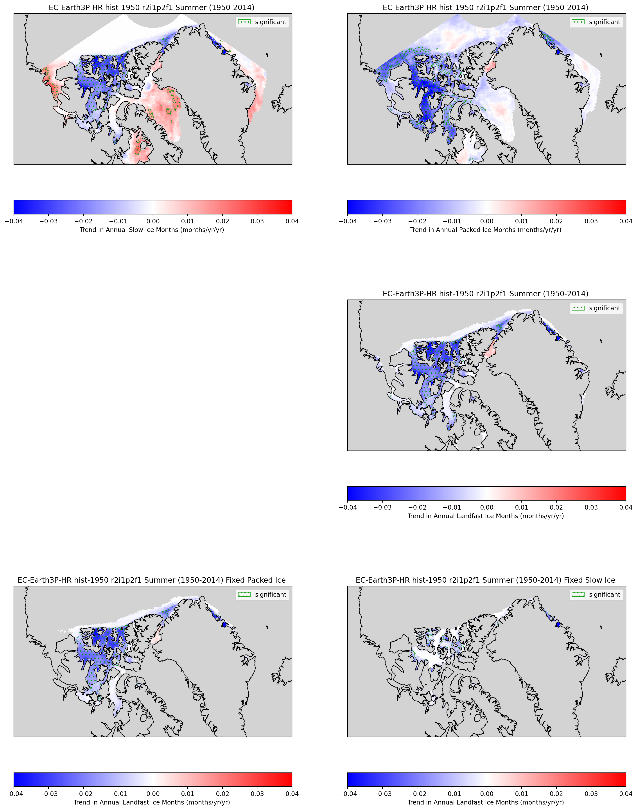

---

## Figures of monthly time series for specific regions
[back to top](#main-text-figures)

### Figure 7: QEI West
[back to top](#main-text-figures)

I will plot time series of the data on a monthly basis to show the variability over time in the QEI West region.
To make this plot of monthly time series focused, I'll only include sea ice speed, concentration, and landfast ice over the first 20 years of the historical experiment.
The code below takes about two and a half minutes to run on my laptop.
```python
import matplotlib.pyplot as plt

from arctichoke.plot.time_series_multi import plot_multi_time_series

# Set up Figure
plt.rcParams["figure.figsize"] = [12, 11]
rows = 3
cols = 1
fig, axs = plt.subplots(rows, cols, squeeze=False)

this_model = 'EC-Earth3P-HR'
this_modification = 'trim_QW_'
x_limits = ['1949-12-12', '1970-01-01']
set_verbose = False

i = 0
# Only include title and legend on the first axis
time_series_title = None
add_legend = True
for variable_id in [
    'sispeed',
    'siconc',
]:
    print(f"\nvariable_id: {variable_id}")
    # Select the correct axis
    this_row = i//cols
    this_col = i%cols
    this_ax = axs[this_row, this_col]
    # Plot the time series
    plot_axis = plot_multi_time_series(
        this_source_id = this_model,
        this_var = variable_id,
        this_modification = this_modification,
        add_regression = False,
        call_sum_by_year = False,
        select_summer = False,
        plt_title = time_series_title,
        include_legend = add_legend,
        xlims = x_limits,
        fig = fig,
        axis = this_ax,
        verbose = set_verbose,
    )
    # Only include title and legend on the first axis
    time_series_title = ''
    add_legend = False
    i += 1

for this_version_id in [
    'v20260617',
    # 'with_sispeed_clim',
    # 'with_siconc_clim',
]:
    print(f"\nvariable id: silandfast for {this_version_id}")
    # Select the correct axis
    this_row = i//cols
    this_col = i%cols
    this_ax = axs[this_row, this_col]
    # Plot the time series
    plot_axis = plot_multi_time_series(
        this_source_id = this_model,
        this_var = 'silandfast',
        this_modification = this_modification,
        this_version_id = this_version_id,
        add_regression = False,
        call_sum_by_year = False,
        select_summer = False,
        plt_title = time_series_title,
        include_legend = add_legend,
        xlims = x_limits,
        fig = fig,
        axis = this_ax,
        verbose = set_verbose,
    )
    # Only include title and legend on the first axis
    time_series_title = ''
    add_legend = False
    i += 1

# Save the plot to file
plt.savefig('docs/docs_results/main_figures-img/Figure_7.png', dpi=200, bbox_inches='tight')

plt.show()
```
```console

variable_id: sispeed

variable_id: siconc

variable id: silandfast for v20260617
```
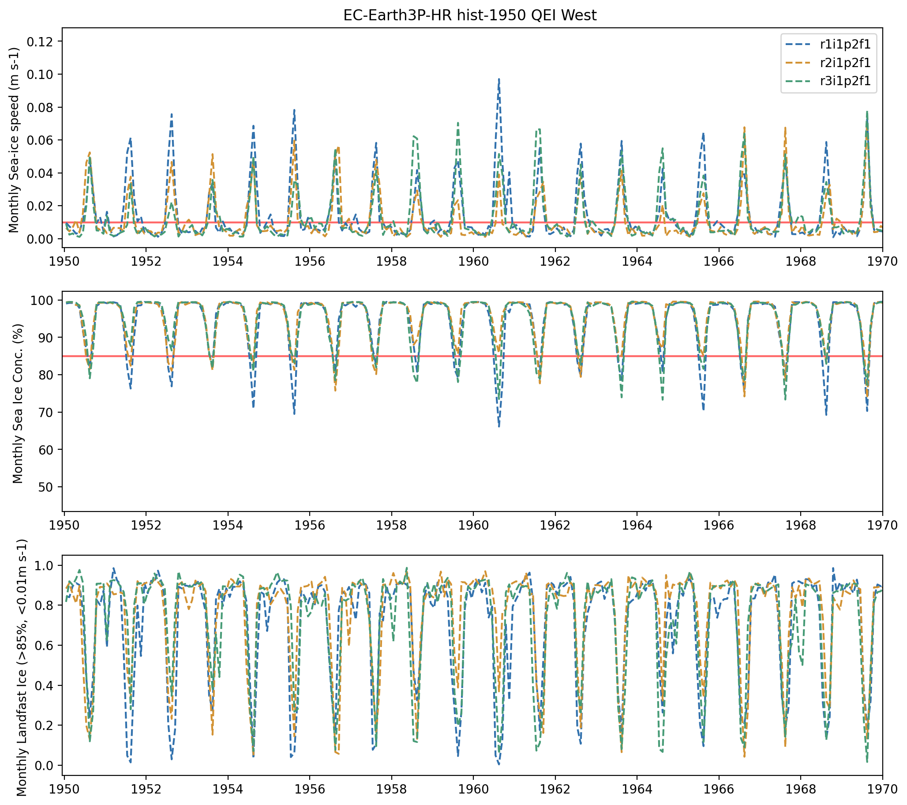

---

## Figures of trends in specific regions
[back to top](#main-text-figures)

The next few figures show time series of particular variables for the three specific regions defined in the paper, QEI West, Parry Channel, and Nares Strait, all for `EC-Earth3P-HR`.

### Figure 8: QEI West
[back to top](#main-text-figures)

First, I'll make a plot to show the exact region we defined to be QEI West.
For this, I'll make a map of the landfast ice climatology to be able to have a point of comparison for the subsequent time series plots.
I can make this map in two different ways.
First, I can plot the original data using `hvplot`.
Note that, since `hvplot` produces interactive maps, I can adjust the framing of the region before saving the image.
```python
import xarray as xr

from arctichoke.dataset import select_months, trim_latlon
from arctichoke.dataset.clim_mask import make_clim_mask
from arctichoke.path import list_variable_files
from arctichoke.params import QW_BBOX, sea_ice_vars
from arctichoke.plot import plot_map

this_model = 'EC-Earth3P-HR'
this_experiment = 'hist-1950'
this_modification = 'trim_CAA_'
this_si_var = 'silandfast'
set_verbose = False

for variant_label in [
    'r1i1p2f1', 
    # 'r2i1p2f1', 
    # 'r3i1p2f1',
]:
    # Get the relevant file path
    sivar_clim_file = list_variable_files(
        source_id = this_model,
        variable_id = f'{this_si_var}_month_mean',
        experiment_id = this_experiment,
        variant_label = variant_label,
        with_modification = this_modification,
        verbose = set_verbose,
    )
    # Select just the summer months
    dataset_clim = select_months(sivar_clim_file, time_dim='month')
    # Trim to this specific area
    dataset_clim = trim_latlon(
        dataset = dataset_clim,
        map_bbox = QW_BBOX,
        precise_trim = True,
        verbose = set_verbose,
    )
    # Determine whether this is a regular or marker variable
    if this_si_var in sea_ice_vars.keys():
        if sea_ice_vars[this_si_var]['marker_var']:
            # Take the sum across the 12 months
            dataset_clim = dataset_clim.sum(dim='month', min_count=1)
        else:
            # Take the mean across the 12 months
            dataset_clim = dataset_clim.mean(dim='month')
    else:
        raise ValueError(f"(Plotting climatologies) `this_si_var={this_si_var}` is not in the `sea_ice_vars` dictionary. Available variables: {sea_ice_vars.keys()}")
    # Adjust the `long_name` attribute to change the colorbar label
    dataset_clim[f'{this_si_var}_month_mean'].attrs['long_name'] = dataset_clim[f'{this_si_var}_month_mean'].attrs['long_name'].replace('onthly m', '')
    # Plot the data on a map
    this_map = plot_map(
        dataset_clim,
        f'{this_si_var}_month_mean',
        clims = [0,5],
        map_bbox = QW_BBOX,
        mark_bbox = True,
        use_hvplot = True,
        verbose = set_verbose,
    )
    display(this_map)
```
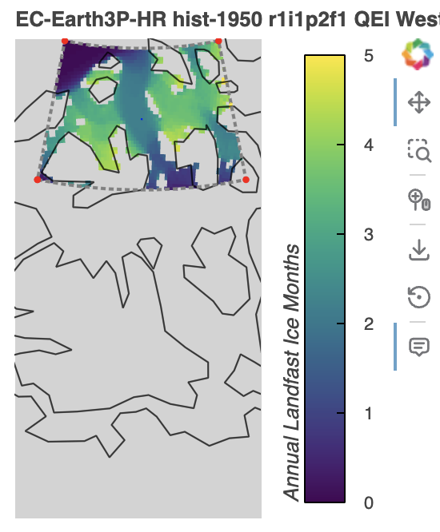

Those plots show exactly the information that I will be including in the time series plots.
However, the aspect ratio of these plots are difficult to adjust and they are difficult to integrate with a larger figure.

I can make versions of this type of plot if I first interpolate so I can use Cartopy.
However, then I need to remember that the pixels don't line up exactly with where the model actually has that information, which becomes more relevant at this regional scale.
First, I'll generate a $\frac{1}{16}\times\frac{1}{16}$ degree grid on which to interpolate.
```python
from arctichoke.dataset import make_example_latlon_grid

target_grid = make_example_latlon_grid(
    save_as = 'data/target_grid_1-16_deg.nc',
    lat_step = 1/16,
    lon_step = 1/16,
)
print(target_grid)
```
```console
<xarray.Dataset> Size: 133MB
Dimensions:   (lat: 2881, lon: 5761)
Coordinates:
  * lat       (lat) float64 23kB -90.0 -89.94 -89.88 -89.81 ... 89.88 89.94 90.0
  * lon       (lon) float64 46kB -180.0 -179.9 -179.9 ... 179.9 179.9 180.0
Data variables:
    test_var  (lat, lon) float64 133MB 0.0 1.0 2.0 ... 1.66e+07 1.66e+07
Attributes:
    grid:     N216
```

Next, I'll use that grid for the map, while also generating the time series plots.
The code below takes about four minutes to run on my laptop.
```python
import matplotlib.pyplot as plt

from arctichoke.plot.time_series_multi import plot_multi_time_series

# Set up Figure
plt.rcParams["figure.figsize"] = [24, 12]
rows = 2
cols = 3
fig, axs = plt.subplots(rows, cols, squeeze=False)

this_model = 'EC-Earth3P-HR'
this_modification = 'trim_QW_'
aggregate_yearly = True
only_summer = True
set_verbose = False

# Plot a map of the landfast ice climatology for this region
if True:
    from arctichoke.dataset import select_months, trim_latlon
    from arctichoke.dataset.interp_dataset import interp_to_reg_grid
    from arctichoke.path import list_variable_files
    from arctichoke.params import QW_BBOX
    from arctichoke.plot import plot_map
    variant_label = 'r1i1p2f1'
    print(f'Now plotting map of {variant_label}')
    this_si_var = 'silandfast'
    # Get the relevant file path
    sivar_clim_file = list_variable_files(
        source_id = this_model,
        variable_id = f'{this_si_var}_month_mean',
        experiment_id = 'hist-1950',
        variant_label = variant_label,
        with_modification = 'trim_CAA_',
        verbose = set_verbose,
    )
    # Select just the summer months
    dataset_clim = select_months(sivar_clim_file, time_dim='month')
    # Trim to this specific area
    dataset_clim = trim_latlon(
        dataset = dataset_clim,
        map_bbox = QW_BBOX,
        precise_trim = True,
        verbose = set_verbose,
    )
    # Take the sum across the 12 months
    dataset_clim = dataset_clim.sum(dim='month', min_count=1)
    # Adjust the `long_name` attribute to change the colorbar label
    dataset_clim[f'{this_si_var}_month_mean'].attrs['long_name'] = dataset_clim[f'{this_si_var}_month_mean'].attrs['long_name'].replace('onthly m', '')
    # Interpolate the data
    dataset_interp = interp_to_reg_grid(
        dataset = dataset_clim,
        targetgrid = 'data/target_grid_1-16_deg.nc',
        trim_to_bbox = QW_BBOX,
        verbose = set_verbose,
    )
    # Plot the data on a map
    this_map, plot_map_kwargs = plot_map(
        dataset_interp,
        f'{this_si_var}_month_mean',
        fig = fig,
        axis = axs[0,0],
        clims = [0,5],
        map_bbox = QW_BBOX,
        mark_bbox = True,
        use_hvplot = False,
        return_plot_map_kwargs = True,
        verbose = set_verbose,
    )

# Skip the first axis
i = 1
# Only include legend on the first axis
add_legend = True
for variable_id in [
    'sispeed',
    'siconc',
    # 'sislow',
    # 'sipacked',
]:
    # Select the correct axis
    this_row = i//cols
    this_col = i%cols
    this_ax = axs[this_row, this_col]
    if 'siconc' in variable_id:
        print(f"variable_id: {variable_id} where sithick is > 2m")
        # Plot the time series for sea ice concentration for thick ice
        plot_axis = plot_multi_time_series(
            this_source_id = this_model,
            this_var = variable_id,
            this_modification = this_modification,
            mask_by_sithick = True,
            call_sum_by_year = aggregate_yearly,
            select_summer = only_summer,
            include_legend = add_legend,
            fig = fig,
            axis = this_ax,
            verbose = set_verbose,
        )
    else:
        print(f"\nvariable_id: {variable_id}")
        # Plot the time series
        plot_axis = plot_multi_time_series(
            this_source_id = this_model,
            this_var = variable_id,
            this_modification = this_modification,
            call_sum_by_year = aggregate_yearly,
            select_summer = only_summer,
            include_legend = add_legend,
            fig = fig,
            axis = this_ax,
            verbose = set_verbose,
        )
    # Only include legend on the first axis
    add_legend = False
    i += 1

for this_version_id in [
    'v20260617',
    'with_siconc_clim',
    'with_sispeed_clim',
]:
    print(f'\nvariable id: silandfast for {this_version_id}')
    # Select the correct axis
    this_row = i//cols
    this_col = i%cols
    this_ax = axs[this_row, this_col]
    # Plot the time series
    plot_axis = plot_multi_time_series(
        this_source_id = this_model,
        this_var = 'silandfast',
        this_modification = this_modification,
        this_version_id = this_version_id,
        call_sum_by_year = aggregate_yearly,
        select_summer = only_summer,
        include_legend = add_legend,
        fig = fig,
        axis = this_ax,
        verbose = set_verbose,
    )
    # Only include legend on the first axis
    add_legend = False
    i += 1

# Save the plot to file
plt.savefig('docs/docs_results/main_figures-img/Figure_8.png', dpi=200, bbox_inches='tight')

plt.show()
```
```console
Now plotting map of r1i1p2f1

variable_id: sispeed
(plot_time_series) Slope of `sispeed_year_mean` regression line:  2.40936e-04
(plot_time_series) Slope of `sispeed_year_mean` regression line:  4.04943e-04
(plot_time_series) Slope of `sispeed_year_mean` regression line:  4.24609e-04
variable_id: siconc where sithick is > 2m
(plot_time_series) Slope of `siconc_si2mthick_year_mean` regression line: -7.49443e-02
(plot_time_series) Slope of `siconc_si2mthick_year_mean` regression line: -1.21773e-01
(plot_time_series) Slope of `siconc_si2mthick_year_mean` regression line: -1.48875e-01

variable id: silandfast for v20260617
(plot_time_series) Slope of `silandfast_year_sum` regression line: -1.46268e-02
(plot_time_series) Slope of `silandfast_year_sum` regression line: -2.46585e-02
(plot_time_series) Slope of `silandfast_year_sum` regression line: -2.06017e-02

variable id: silandfast for with_siconc_clim
(plot_time_series) Slope of `silandfast_year_sum` regression line: -1.28967e-02
(plot_time_series) Slope of `silandfast_year_sum` regression line: -2.25835e-02
(plot_time_series) Slope of `silandfast_year_sum` regression line: -1.79259e-02

variable id: silandfast for with_sispeed_clim
(plot_time_series) Slope of `silandfast_year_sum` regression line: -1.88192e-03
(plot_time_series) Slope of `silandfast_year_sum` regression line: -5.47205e-03
(plot_time_series) Slope of `silandfast_year_sum` regression line: -5.30801e-03
```
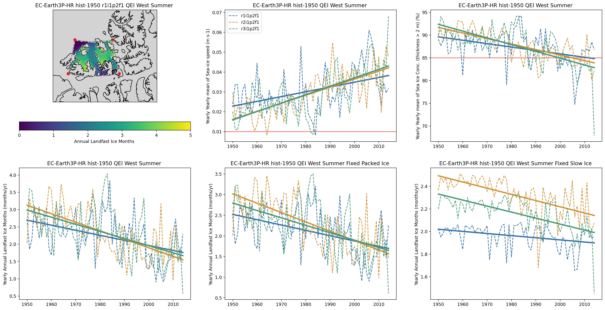

### Figure 9: Parry Channel
[back to top](#main-text-figures)

Next, I'll make a plot to show the exact region we defined to be Parry Channel.
For this, I'll make a map of the landfast ice climatology to be able to have a point of comparison for the subsequent time series plots.
```python
import xarray as xr

from arctichoke.dataset import select_months, trim_latlon
from arctichoke.dataset.clim_mask import make_clim_mask
from arctichoke.path import list_variable_files
from arctichoke.params import PC_BBOX, sea_ice_vars
from arctichoke.plot import plot_map

this_model = 'EC-Earth3P-HR'
this_experiment = 'hist-1950'
this_modification = 'trim_CAA_'
this_si_var = 'silandfast'
set_verbose = False

for variant_label in [
    'r1i1p2f1', 
    # 'r2i1p2f1', 
    # 'r3i1p2f1',
]:
    # Get the relevant file path
    sivar_clim_file = list_variable_files(
        source_id = this_model,
        variable_id = f'{this_si_var}_month_mean',
        experiment_id = this_experiment,
        variant_label = variant_label,
        with_modification = this_modification,
        verbose = set_verbose,
    )
    # Select just the summer months
    dataset_clim = select_months(sivar_clim_file, time_dim='month')
    # Trim to this specific area
    dataset_clim = trim_latlon(
        dataset = dataset_clim,
        map_bbox = PC_BBOX,
        precise_trim = True,
        verbose = set_verbose,
    )
    # Determine whether this is a regular or marker variable
    if this_si_var in sea_ice_vars.keys():
        if sea_ice_vars[this_si_var]['marker_var']:
            # Take the sum across the 12 months
            dataset_clim = dataset_clim.sum(dim='month', min_count=1)
        else:
            # Take the mean across the 12 months
            dataset_clim = dataset_clim.mean(dim='month')
    else:
        raise ValueError(f"(Plotting climatologies) `this_si_var={this_si_var}` is not in the `sea_ice_vars` dictionary. Available variables: {sea_ice_vars.keys()}")
    # Adjust the `long_name` attribute to change the colorbar label
    dataset_clim[f'{this_si_var}_month_mean'].attrs['long_name'] = dataset_clim[f'{this_si_var}_month_mean'].attrs['long_name'].replace('onthly m', '')
    # Plot the data on a map
    this_map = plot_map(
        dataset_clim,
        f'{this_si_var}_month_mean',
        clims = [0,5],
        map_bbox = PC_BBOX,
        mark_bbox = True,
        use_hvplot = True,
        verbose = set_verbose,
    )
    display(this_map)
```
![Figure_9a_hvplot.png]

Next, I'll make a figure like I did for QEI West above, including a regional map using Cartopy, as well as time series of yearly-aggregates for certain variables.
The below code takes about four minutes to run on my laptop.
```python
import matplotlib.pyplot as plt

from arctichoke.plot.time_series_multi import plot_multi_time_series

# Set up Figure
plt.rcParams["figure.figsize"] = [24, 12]
rows = 2
cols = 3
fig, axs = plt.subplots(rows, cols, squeeze=False)

this_model = 'EC-Earth3P-HR'
this_modification = 'trim_PC_'
aggregate_yearly = True
only_summer = True
set_verbose = False

# Plot a map of the landfast ice climatology for this region
if True:
    from arctichoke.dataset import select_months, trim_latlon
    from arctichoke.dataset.interp_dataset import interp_to_reg_grid
    from arctichoke.path import list_variable_files
    from arctichoke.params import PC_BBOX
    from arctichoke.plot import plot_map
    variant_label = 'r1i1p2f1'
    print(f'Now plotting map of {variant_label}')
    this_si_var = 'silandfast'
    # Get the relevant file path
    sivar_clim_file = list_variable_files(
        source_id = this_model,
        variable_id = f'{this_si_var}_month_mean',
        experiment_id = 'hist-1950',
        variant_label = variant_label,
        with_modification = 'trim_CAA_',
        verbose = set_verbose,
    )
    # Select just the summer months
    dataset_clim = select_months(sivar_clim_file, time_dim='month')
    # Trim to this specific area
    dataset_clim = trim_latlon(
        dataset = dataset_clim,
        map_bbox = PC_BBOX,
        precise_trim = True,
        verbose = set_verbose,
    )
    # Take the sum across the 12 months
    dataset_clim = dataset_clim.sum(dim='month', min_count=1)
    # Adjust the `long_name` attribute to change the colorbar label
    dataset_clim[f'{this_si_var}_month_mean'].attrs['long_name'] = dataset_clim[f'{this_si_var}_month_mean'].attrs['long_name'].replace('onthly m', '')
    # Interpolate the data
    dataset_interp = interp_to_reg_grid(
        dataset = dataset_clim,
        targetgrid = 'data/target_grid_1-16_deg.nc',
        trim_to_bbox = PC_BBOX,
        verbose = set_verbose,
    )
    # Plot the data on a map
    this_map, plot_map_kwargs = plot_map(
        dataset_interp,
        f'{this_si_var}_month_mean',
        fig = fig,
        axis = axs[0,0],
        clims = [0,5],
        map_bbox = PC_BBOX,
        mark_bbox = True,
        use_hvplot = False,
        return_plot_map_kwargs = True,
        verbose = set_verbose,
    )

# Skip the first axis
i = 1
# Only include legend on the first axis
add_legend = True
for variable_id in [
    'sispeed',
    'siconc',
    # 'sislow',
    # 'sipacked',
]:
    # Select the correct axis
    this_row = i//cols
    this_col = i%cols
    this_ax = axs[this_row, this_col]
    if 'siconc' in variable_id:
        print(f"variable_id: {variable_id} where sithick is > 2m")
        # Plot the time series for sea ice concentration for thick ice
        plot_axis = plot_multi_time_series(
            this_source_id = this_model,
            this_var = variable_id,
            this_modification = this_modification,
            mask_by_sithick = True,
            call_sum_by_year = aggregate_yearly,
            select_summer = only_summer,
            include_legend = add_legend,
            fig = fig,
            axis = this_ax,
            verbose = set_verbose,
        )
    else:
        print(f"\nvariable_id: {variable_id}")
        # Plot the time series
        plot_axis = plot_multi_time_series(
            this_source_id = this_model,
            this_var = variable_id,
            this_modification = this_modification,
            call_sum_by_year = aggregate_yearly,
            select_summer = only_summer,
            include_legend = add_legend,
            fig = fig,
            axis = this_ax,
            verbose = set_verbose,
        )
    # Only include legend on the first axis
    add_legend = False
    i += 1

for this_version_id in [
    'v20260617',
    'with_siconc_clim',
    'with_sispeed_clim',
]:
    print(f'\nvariable id: silandfast for {this_version_id}')
    # Select the correct axis
    this_row = i//cols
    this_col = i%cols
    this_ax = axs[this_row, this_col]
    # Plot the time series
    plot_axis = plot_multi_time_series(
        this_source_id = this_model,
        this_var = 'silandfast',
        this_modification = this_modification,
        this_version_id = this_version_id,
        call_sum_by_year = aggregate_yearly,
        select_summer = only_summer,
        include_legend = add_legend,
        fig = fig,
        axis = this_ax,
        verbose = set_verbose,
    )
    # Only include legend on the first axis
    add_legend = False
    i += 1

# Save the plot to file
plt.savefig('docs/docs_results/main_figures-img/Figure_9.png', dpi=200, bbox_inches='tight')

plt.show()
```
```console
Now plotting map of r1i1p2f1

variable_id: sispeed
(plot_time_series) Slope of `sispeed_year_mean` regression line:  3.14328e-04
(plot_time_series) Slope of `sispeed_year_mean` regression line:  5.99957e-04
(plot_time_series) Slope of `sispeed_year_mean` regression line:  7.21741e-04
variable_id: siconc where sithick is > 2m
(plot_time_series) Slope of `siconc_si2mthick_year_mean` regression line: -1.85276e-01
(plot_time_series) Slope of `siconc_si2mthick_year_mean` regression line: -3.22107e-01
(plot_time_series) Slope of `siconc_si2mthick_year_mean` regression line: -4.68885e-01

variable id: silandfast for v20260617
(plot_time_series) Slope of `silandfast_year_sum` regression line: -6.36820e-03
(plot_time_series) Slope of `silandfast_year_sum` regression line: -1.63635e-02
(plot_time_series) Slope of `silandfast_year_sum` regression line: -1.74537e-02

variable id: silandfast for with_siconc_clim
(plot_time_series) Slope of `silandfast_year_sum` regression line: -5.76872e-03
(plot_time_series) Slope of `silandfast_year_sum` regression line: -1.51612e-02
(plot_time_series) Slope of `silandfast_year_sum` regression line: -1.60920e-02

variable id: silandfast for with_sispeed_clim
(plot_time_series) Slope of `silandfast_year_sum` regression line: -2.43093e-04
(plot_time_series) Slope of `silandfast_year_sum` regression line: -1.32291e-03
(plot_time_series) Slope of `silandfast_year_sum` regression line: -2.14862e-03
```
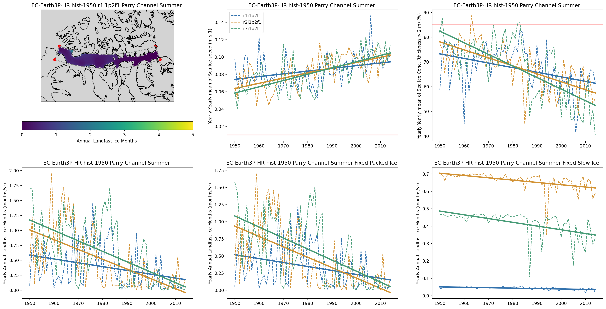

### Figure 10: Nares Strait
[back to top](#main-text-figures)

Like above for the other regions, I'll make a plot to show the exact region we defined to be Nares Strait, first using `hvplot`.
```python
import xarray as xr

from arctichoke.dataset import select_months, trim_latlon
from arctichoke.dataset.clim_mask import make_clim_mask
from arctichoke.path import list_variable_files
from arctichoke.params import NS_BBOX, sea_ice_vars
from arctichoke.plot import plot_map

this_model = 'EC-Earth3P-HR'
this_experiment = 'hist-1950'
this_modification = 'trim_CAA_'
this_si_var = 'silandfast'
set_verbose = False

for variant_label in [
    'r1i1p2f1', 
    # 'r2i1p2f1', 
    # 'r3i1p2f1',
]:
    # Get the relevant file path
    sivar_clim_file = list_variable_files(
        source_id = this_model,
        variable_id = f'{this_si_var}_month_mean',
        experiment_id = this_experiment,
        variant_label = variant_label,
        with_modification = this_modification,
        verbose = set_verbose,
    )
    # Select just the summer months
    dataset_clim = select_months(sivar_clim_file, time_dim='month')
    # Trim to this specific area
    dataset_clim = trim_latlon(
        dataset = dataset_clim,
        map_bbox = NS_BBOX,
        precise_trim = True,
        verbose = set_verbose,
    )
    # Determine whether this is a regular or marker variable
    if this_si_var in sea_ice_vars.keys():
        if sea_ice_vars[this_si_var]['marker_var']:
            # Take the sum across the 12 months
            dataset_clim = dataset_clim.sum(dim='month', min_count=1)
        else:
            # Take the mean across the 12 months
            dataset_clim = dataset_clim.mean(dim='month')
    else:
        raise ValueError(f"(Plotting climatologies) `this_si_var={this_si_var}` is not in the `sea_ice_vars` dictionary. Available variables: {sea_ice_vars.keys()}")
    # Adjust the `long_name` attribute to change the colorbar label
    dataset_clim[f'{this_si_var}_month_mean'].attrs['long_name'] = dataset_clim[f'{this_si_var}_month_mean'].attrs['long_name'].replace('onthly m', '')
    # Plot the data on a map
    this_map = plot_map(
        dataset_clim,
        f'{this_si_var}_month_mean',
        clims = [0,5],
        map_bbox = NS_BBOX,
        mark_bbox = True,
        use_hvplot = True,
        verbose = set_verbose,
    )
    display(this_map)
```
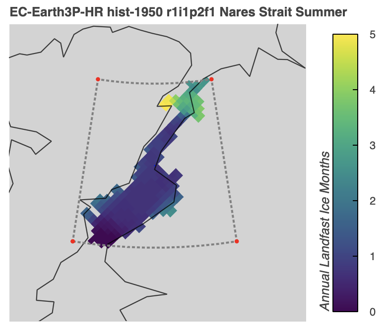

Next, I'll make a figure like I did for the other regions above including a regional map using Cartopy, as well as time series of yearly-aggregates for certain variables.
The below code takes about four minutes to run on my laptop.
```python
import matplotlib.pyplot as plt

from arctichoke.plot.time_series_multi import plot_multi_time_series

# Set up Figure
plt.rcParams["figure.figsize"] = [24, 12]
rows = 2
cols = 3
fig, axs = plt.subplots(rows, cols, squeeze=False)

this_model = 'EC-Earth3P-HR'
this_modification = 'trim_NS_'
aggregate_yearly = True
only_summer = True
set_verbose = False

# Plot a map of the landfast ice climatology for this region
if True:
    from arctichoke.dataset import select_months, trim_latlon
    from arctichoke.dataset.interp_dataset import interp_to_reg_grid
    from arctichoke.path import list_variable_files
    from arctichoke.params import NS_BBOX
    from arctichoke.plot import plot_map
    variant_label = 'r1i1p2f1'
    print(f'Now plotting map of {variant_label}')
    this_si_var = 'silandfast'
    # Get the relevant file path
    sivar_clim_file = list_variable_files(
        source_id = this_model,
        variable_id = f'{this_si_var}_month_mean',
        experiment_id = 'hist-1950',
        variant_label = variant_label,
        with_modification = 'trim_CAA_',
        verbose = set_verbose,
    )
    # Select just the summer months
    dataset_clim = select_months(sivar_clim_file, time_dim='month')
    # Trim to this specific area
    dataset_clim = trim_latlon(
        dataset = dataset_clim,
        map_bbox = NS_BBOX,
        precise_trim = True,
        verbose = set_verbose,
    )
    # Take the sum across the 12 months
    dataset_clim = dataset_clim.sum(dim='month', min_count=1)
    # Adjust the `long_name` attribute to change the colorbar label
    dataset_clim[f'{this_si_var}_month_mean'].attrs['long_name'] = dataset_clim[f'{this_si_var}_month_mean'].attrs['long_name'].replace('onthly m', '')
    # Interpolate the data
    dataset_interp = interp_to_reg_grid(
        dataset = dataset_clim,
        targetgrid = 'data/target_grid_1-16_deg.nc',
        trim_to_bbox = NS_BBOX,
        verbose = set_verbose,
    )
    # Plot the data on a map
    this_map, plot_map_kwargs = plot_map(
        dataset_interp,
        f'{this_si_var}_month_mean',
        fig = fig,
        axis = axs[0,0],
        clims = [0,5],
        map_bbox = NS_BBOX,
        mark_bbox = True,
        use_hvplot = False,
        return_plot_map_kwargs = True,
        verbose = set_verbose,
    )

# Skip the first axis
i = 1
# Only include legend on the first axis
add_legend = True
for variable_id in [
    'sispeed',
    'siconc',
    # 'sislow',
    # 'sipacked',
]:
    # Select the correct axis
    this_row = i//cols
    this_col = i%cols
    this_ax = axs[this_row, this_col]
    if 'siconc' in variable_id:
        print(f"variable_id: {variable_id} where sithick is > 2m")
        # Plot the time series for sea ice concentration for thick ice
        plot_axis = plot_multi_time_series(
            this_source_id = this_model,
            this_var = variable_id,
            this_modification = this_modification,
            mask_by_sithick = True,
            call_sum_by_year = aggregate_yearly,
            select_summer = only_summer,
            include_legend = add_legend,
            fig = fig,
            axis = this_ax,
            verbose = set_verbose,
        )
    else:
        print(f"\nvariable_id: {variable_id}")
        # Plot the time series
        plot_axis = plot_multi_time_series(
            this_source_id = this_model,
            this_var = variable_id,
            this_modification = this_modification,
            call_sum_by_year = aggregate_yearly,
            select_summer = only_summer,
            include_legend = add_legend,
            fig = fig,
            axis = this_ax,
            verbose = set_verbose,
        )
    # Only include legend on the first axis
    add_legend = False
    i += 1

for this_version_id in [
    'v20260617',
    'with_siconc_clim',
    'with_sispeed_clim',
]:
    print(f'\nvariable id: silandfast for {this_version_id}')
    # Select the correct axis
    this_row = i//cols
    this_col = i%cols
    this_ax = axs[this_row, this_col]
    # Plot the time series
    plot_axis = plot_multi_time_series(
        this_source_id = this_model,
        this_var = 'silandfast',
        this_modification = this_modification,
        this_version_id = this_version_id,
        call_sum_by_year = aggregate_yearly,
        select_summer = only_summer,
        include_legend = add_legend,
        fig = fig,
        axis = this_ax,
        verbose = set_verbose,
    )
    # Only include legend on the first axis
    add_legend = False
    i += 1

# Save the plot to file
plt.savefig('docs/docs_results/main_figures-img/Figure_10.png', dpi=200, bbox_inches='tight')

plt.show()
```
```console
Now plotting map of r1i1p2f1

variable_id: sispeed
(plot_time_series) Slope of `sispeed_year_mean` regression line:  3.57291e-04
(plot_time_series) Slope of `sispeed_year_mean` regression line: -5.49426e-05
(plot_time_series) Slope of `sispeed_year_mean` regression line:  9.62230e-04
variable_id: siconc where sithick is > 2m
(plot_time_series) Slope of `siconc_si2mthick_year_mean` regression line: -2.32762e-01
(plot_time_series) Slope of `siconc_si2mthick_year_mean` regression line:  1.14792e-01
(plot_time_series) Slope of `siconc_si2mthick_year_mean` regression line: -6.62753e-01

variable id: silandfast for v20260617
(plot_time_series) Slope of `silandfast_year_sum` regression line: -1.24325e-02
(plot_time_series) Slope of `silandfast_year_sum` regression line:  3.39746e-03
(plot_time_series) Slope of `silandfast_year_sum` regression line: -4.39438e-02

variable id: silandfast for with_siconc_clim
(plot_time_series) Slope of `silandfast_year_sum` regression line: -4.86336e-03
(plot_time_series) Slope of `silandfast_year_sum` regression line:  8.22941e-04
(plot_time_series) Slope of `silandfast_year_sum` regression line: -2.04846e-02

variable id: silandfast for with_sispeed_clim
(plot_time_series) Slope of `silandfast_year_sum` regression line: -1.39328e-03
(plot_time_series) Slope of `silandfast_year_sum` regression line: -1.74543e-03
(plot_time_series) Slope of `silandfast_year_sum` regression line: -7.49006e-03
```
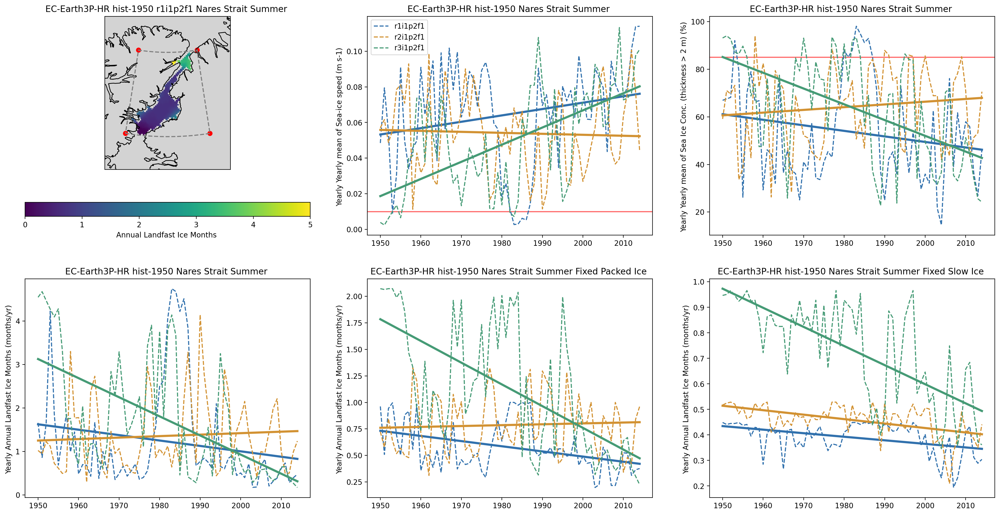

Versions of the plots shown above but for different models, model variants, and regions can be seen in the {doc}`Supplementary figures  <../docs_results/supplementary_figures>`.