# Supplementary figures

Below, I describe how I generated the figures used in the supplementary materials of the paper.
Many of these are very similar to the {doc}`Main text figures <../docs_results/main_figures>`, but for different models, model variants, or regions.
For details on how each of the plotting functions used were developed, see the Analysis guides. 

## Contents

- [Preparation](#preparation)
- [Figures of climatology maps](#figures-of-climatology-maps)
    - [Variants of Figure 1](#variants-of-figure-1)
    - [Variants of Figure 2](#variants-of-figure-2)
- [Figures of trend maps](#figures-of-trend-maps)
    - [Variants of Figure 3 / 5](#variants-of-figure-3--5)
    - [Variants of Figure 4 / 6](#variants-of-figure-4--6)
- [Figures of monthly time series for specific regions](#figures-of-monthly-time-series-for-specific-regions)
    - [Variant of Figure 7](#variants-of-figure-7)
- [Figures of trends in specific regions](#figures-of-trends-in-specific-regions)
    - [Variant of Figure 8](#variant-of-figure-8)
    - [Variant of Figure 9](#variant-of-figure-9)
    - [Variant of Figure 10](#variant-of-figure-10)

---

# Preparation
[back to top](#supplementary-figures)

Just as is for the {doc}`Main text figures  <../docs_results/main_figures>`, most of the plots below rely on interpolating onto a pre-existing target grid file. 
If not previously generated, it is necessary to make such a file using my `make_example_latlon_grid()` function to be a $0.25\times0.25$ degree grid.
```python
from arctichoke.dataset import make_example_latlon_grid

target_grid = make_example_latlon_grid(
    save_as = 'data/target_grid_0-25_deg.nc',
    lat_step = 0.25,
    lon_step = 0.25,
)
print(target_grid)
```
```console
	Overwriting file `data/target_grid_0-25_deg.nc`.
<xarray.Dataset> Size: 8MB
Dimensions:   (lat: 721, lon: 1441)
Coordinates:
  * lat       (lat) float64 6kB -90.0 -89.75 -89.5 -89.25 ... 89.5 89.75 90.0
  * lon       (lon) float64 12kB -180.0 -179.8 -179.5 ... 179.5 179.8 180.0
Data variables:
    test_var  (lat, lon) float64 8MB 0.0 1.0 2.0 ... 1.039e+06 1.039e+06
Attributes:
    grid:     N216
```

Additionally, I'll generate a $\frac{1}{16}\times\frac{1}{16}$ degree grid on which to interpolate regional-scale maps.
```python
from arctichoke.dataset import make_example_latlon_grid

target_grid = make_example_latlon_grid(
    save_as = 'data/target_grid_1-16_deg.nc',
    lat_step = 1/16,
    lon_step = 1/16,
)
print(target_grid)
```
```console
	Overwriting file `data/target_grid_1-16_deg.nc`.
<xarray.Dataset> Size: 133MB
Dimensions:   (lat: 2881, lon: 5761)
Coordinates:
  * lat       (lat) float64 23kB -90.0 -89.94 -89.88 -89.81 ... 89.88 89.94 90.0
  * lon       (lon) float64 46kB -180.0 -179.9 -179.9 ... 179.9 179.9 180.0
Data variables:
    test_var  (lat, lon) float64 133MB 0.0 1.0 2.0 ... 1.66e+07 1.66e+07
Attributes:
    grid:     N216
```

---

## Figures of climatology maps
[back to top](#supplementary-figures)

### Variants of Figure 1
[back to top](#supplementary-figures)

The below figures are in the same fashion as Figure 1 in the main text, including subplots of climatologies (1950-1969) of sea ice thickness, speed, concentration, and concentration where sea ice thickness is greater than 2 meters.
The code below takes about 2 minutes to run on my laptop.
```python
from matplotlib import pyplot as plt
import xarray as xr

from arctichoke.dataset import select_months
from arctichoke.dataset.clim_mask import make_clim_mask
from arctichoke.dataset.interp_dataset import interp_to_reg_grid
from arctichoke.path import list_variable_files
import arctichoke.params as sps
from arctichoke.params import sea_ice_vars
from arctichoke.plot import plot_map
from arctichoke.plot.labels_and_titles import make_title
from arctichoke.plot.stippling import add_hatches

this_experiment = 'hist-1950'
this_modification = 'trim_CAA_'
set_verbose = False

fig_dicts = [
    {
        'this_model': 'EC-Earth3P-HR',
        'variant_labels': [
            # 'r1i1p2f1', 
            'r2i1p2f1', 
            'r3i1p2f1',
        ],
        'clim_mask_si_var': 'siconc',
        'si_vars': [
            'sithick',
            'sispeed',
            'siconc',
            'siconc_si2mthick',
        ],
    },
    {
        'this_model': 'HadGEM3-GC31-MM',
        'variant_labels': [
            'r1i1p1f1', 
            'r1i2p1f1', 
            'r1i3p1f1',
        ],
        'clim_mask_si_var': 'siconc2',
        'si_vars': [
            'sithick',
            'sispeed',
            'siconc2',
            'siconc2_si2mthick',
        ],
    },
]

for fig_dict in fig_dicts:
    this_model = fig_dict['this_model']

    for variant_label in fig_dict['variant_labels']:
        print(f"Model: {this_model}, variant {variant_label}")
        # Create the sea ice mask
        clim_mask_dataset = make_clim_mask(
            this_source_id = this_model,
            this_experiment = this_experiment,
            this_var = fig_dict['clim_mask_si_var'],
            this_variant_label = variant_label,
            this_modification = this_modification,
            verbose = set_verbose
        )

        # Set up Figure
        plt.rcParams["figure.figsize"] = [18, 18]
        rows = 2
        cols = 2
        fig, axs = plt.subplots(rows, cols, squeeze=False)
        i = 0
        for this_si_var in fig_dict['si_vars']:
            print(f"\tNow plotting {this_si_var}")
            # Get the relevant file path
            sivar_clim_file = list_variable_files(
                source_id = this_model,
                variable_id = f'{this_si_var}_month_mean',
                experiment_id = this_experiment,
                variant_label = variant_label,
                with_modification = this_modification,
                verbose = set_verbose,
            )
            # Select just the summer months
            dataset_clim = select_months(sivar_clim_file, time_dim='month')
            # Determine whether this is a regular or marker variable
            if this_si_var in sea_ice_vars.keys():
                if sea_ice_vars[this_si_var]['marker_var']:
                    # Take the sum across the 12 months
                    dataset_clim = dataset_clim.sum(dim='month', min_count=1)
                else:
                    # Take the mean across the 12 months
                    dataset_clim = dataset_clim.mean(dim='month')
            else:
                raise ValueError(f"(Plotting climatologies) `this_si_var={this_si_var}` is not in the `sea_ice_vars` dictionary. Available variables: {sea_ice_vars.keys()}")
            # Copy the variable attributes
            keep_these_attrs = dataset_clim[f'{this_si_var}_month_mean'].attrs
            # Apply the sea ice mask
            dataset_clim[f'{this_si_var}_month_mean'] = dataset_clim[f'{this_si_var}_month_mean'] * clim_mask_dataset[f'{fig_dict['clim_mask_si_var']}_clim_mask']
            # Put the variable attributes back
            dataset_clim[f'{this_si_var}_month_mean'].attrs = keep_these_attrs
            # Adjust the `long_name` attribute to change the colorbar label
            dataset_clim[f'{this_si_var}_month_mean'].attrs['long_name'] = dataset_clim[f'{this_si_var}_month_mean'].attrs['long_name'].replace('onthly m', '')
            # Interpolate the data
            dataset_interp = interp_to_reg_grid(
                dataset = dataset_clim,
                targetgrid = 'data/target_grid_0-25_deg.nc',
                trim_to_bbox = sps.CAA_BBOX,
                verbose = set_verbose,
            )

            # Select the correct axis
            this_row = i//cols
            this_col = i%cols
            this_ax = axs[this_row, this_col]
            # Plot the data on a map
            plot_axis = plot_map(
                dataset_interp,
                f'{this_si_var}_month_mean',
                clims = sea_ice_vars[this_si_var]['plot_range'],
                fig = fig,
                axis = this_ax,
                use_hvplot = False,
                zoom_out_bbox = False,
                verbose = set_verbose,
            )
            # Add hatch marks, if applicable
            if 'siconc' in this_si_var:
                add_hatch = True
                hatch_label = '>85%'
                hatch_levels = [85, 100]
                mark_levels = [False, True]
                hatch_style = '/'
                hatch_density = 4
                hatch_color = sps.hatch_red
                contour_level = 85
            elif 'sispeed' in this_si_var:
                add_hatch = True
                hatch_label = '<1 cm/s'
                hatch_levels = [0, 0.01]
                mark_levels = [True, False]
                hatch_style = '.'
                hatch_density = 7
                hatch_color = sps.hatch_red
                contour_level = 0.01
            else: 
                add_hatch = False
            if add_hatch:
                # Add hatch lines
                handles = add_hatches(
                    plot_axis, 
                    dataset_interp,
                    f'{this_si_var}_month_mean',
                    hatch_label,
                    hatch_levels = hatch_levels,
                    mark_levels = mark_levels,
                    hatch_style = hatch_style,
                    hatch_density = hatch_density,
                    hatch_color = hatch_color,
                    contour_level = contour_level,
                    verbose = set_verbose,
                )

                # Add label for the hatches in the legend
                plot_axis.legend(handles=handles, loc='upper right')
            i += 1

        # Save the plot to file
        plt.savefig(f"docs/docs_results/supplementary_figures-img/Figure_1_{this_model}_{variant_label}.png", dpi=200, bbox_inches='tight')

        plt.show()
```
```console
Model: EC-Earth3P-HR, variant r2i1p2f1
	Now plotting sithick
	Now plotting sispeed
	Now plotting siconc
	Now plotting siconc_si2mthick
```
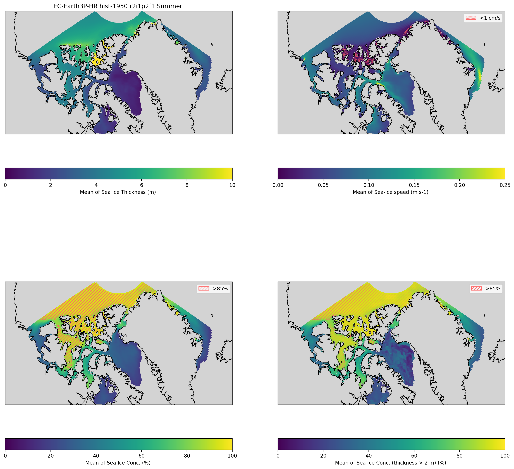

```console
Model: EC-Earth3P-HR, variant r3i1p2f1
	Now plotting sithick
	Now plotting sispeed
	Now plotting siconc
	Now plotting siconc_si2mthick
```
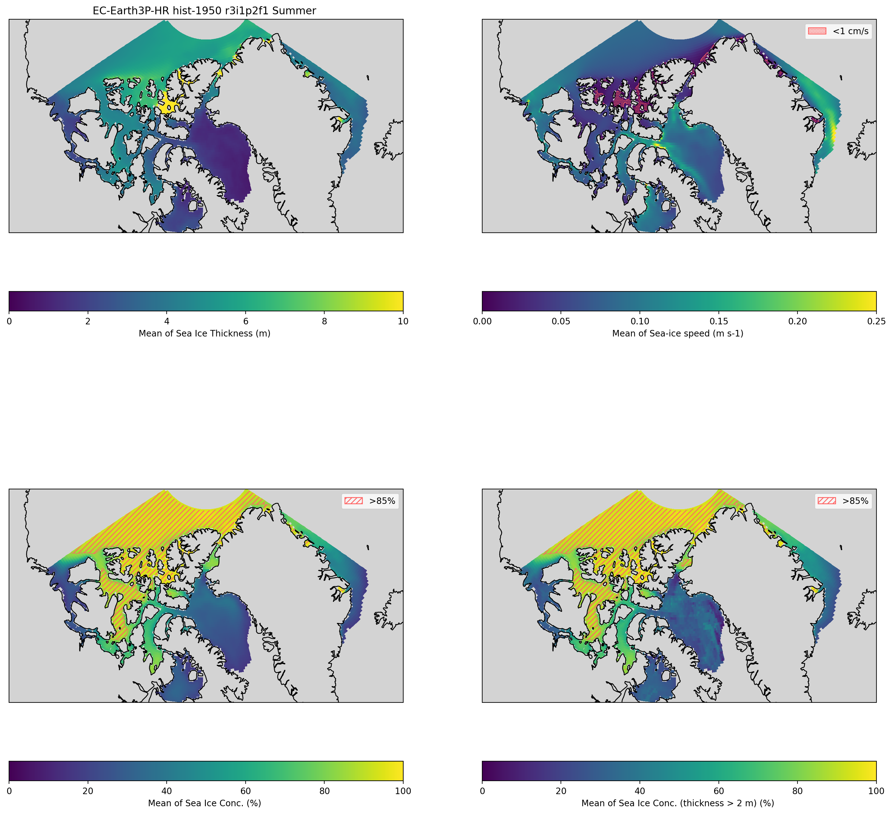

```console
Model: HadGEM3-GC31-MM, variant r1i1p1f1
	Now plotting sithick
	Now plotting sispeed
	Now plotting siconc2
	Now plotting siconc2_si2mthick
```


```console
Model: HadGEM3-GC31-MM, variant r1i2p1f1
	Now plotting sithick
	Now plotting sispeed
	Now plotting siconc2
	Now plotting siconc2_si2mthick
```
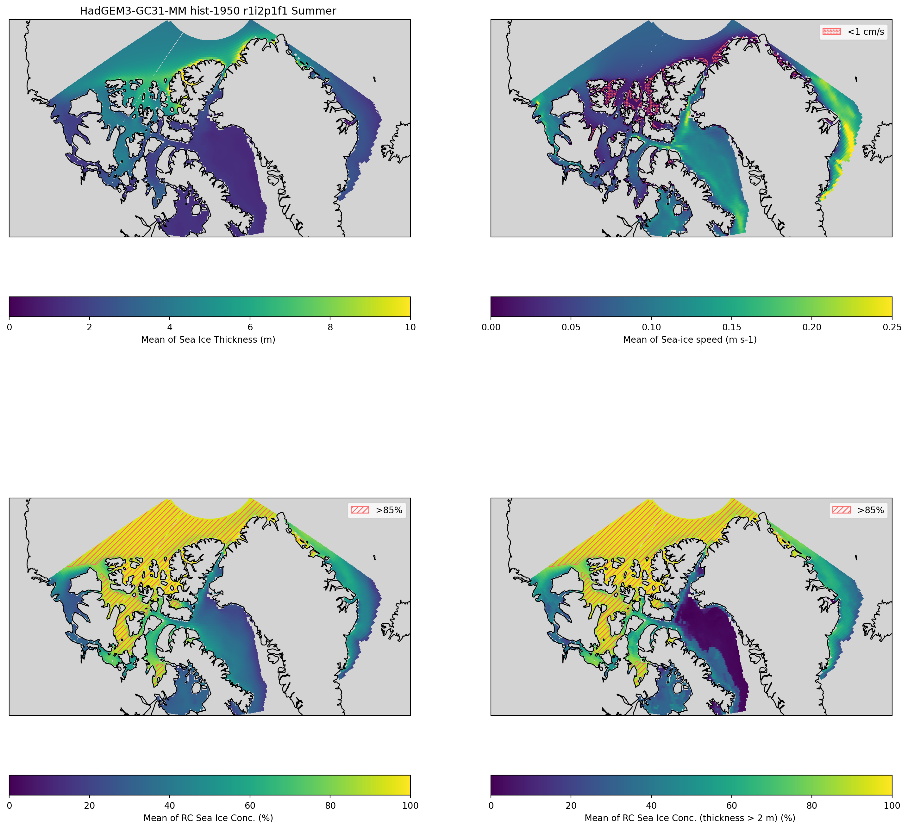

```console
Model: HadGEM3-GC31-MM, variant r1i3p1f1
	Now plotting sithick
	Now plotting sispeed
	Now plotting siconc2
	Now plotting siconc2_si2mthick
```


### Variants of Figure 2
[back to top](#supplementary-figures)

The below figures are in the same fashion as Figure 2 in the main text, including subplots of climatologies (1950-1969) of slow ice, packed ice, and landfast ice.
The code below takes about one and a half minutes to run on my laptop.
```python
import cartopy.crs as crs
from matplotlib import pyplot as plt
import numpy as np
import pandas as pd
import xarray as xr

from arctichoke.dataset import select_months
from arctichoke.dataset.clim_mask import make_clim_mask
from arctichoke.dataset.interp_dataset import interp_to_reg_grid
from arctichoke.path import list_variable_files
import arctichoke.params as sps
from arctichoke.params import sea_ice_vars
from arctichoke.plot import plot_map
from arctichoke.plot.labels_and_titles import make_title
from arctichoke.plot.stippling import add_hatches

this_experiment = 'hist-1950'
this_modification = 'trim_CAA_'
set_verbose = False

fig_dicts = [
    {
        'this_model': 'EC-Earth3P-HR',
        'variant_labels': [
            # 'r1i1p2f1', 
            'r2i1p2f1', 
            'r3i1p2f1',
        ],
        'clim_mask_si_var': 'siconc',
        'si_vars': [
            'sislow',
            'sipacked',
            'silandfast',
        ],
    },
    {
        'this_model': 'HadGEM3-GC31-MM',
        'variant_labels': [
            'r1i1p1f1', 
            'r1i2p1f1', 
            'r1i3p1f1',
        ],
        'clim_mask_si_var': 'siconc2',
        'si_vars': [
            'sislow',
            'sipacked',
            'silandfast',
        ],
    },
]

for fig_dict in fig_dicts:
    this_model = fig_dict['this_model']

    for variant_label in fig_dict['variant_labels']:
        print(f"Model: {this_model}, variant {variant_label}")
        # Create the sea ice mask
        clim_mask_dataset = make_clim_mask(
            this_source_id = this_model,
            this_experiment = this_experiment,
            this_var = fig_dict['clim_mask_si_var'],
            this_variant_label = variant_label,
            this_modification = this_modification,
            verbose = set_verbose
        )

        # Set up Figure
        plt.rcParams["figure.figsize"] = [18, 18]
        rows = 2
        cols = 2
        fig, axs = plt.subplots(rows, cols, squeeze=False)
        i = 0
        for this_si_var in fig_dict['si_vars']:
            print(f"\tNow plotting {this_si_var}")
            # Get the relevant file path
            sivar_clim_file = list_variable_files(
                source_id = this_model,
                variable_id = f'{this_si_var}_month_mean',
                experiment_id = this_experiment,
                variant_label = variant_label,
                with_modification = this_modification,
                verbose = set_verbose,
            )
            # Select just the summer months
            dataset_clim = select_months(sivar_clim_file, time_dim='month')
            # Determine whether this is a regular or marker variable
            if this_si_var in sea_ice_vars.keys():
                if sea_ice_vars[this_si_var]['marker_var']:
                    # Take the sum across the 12 months
                    dataset_clim = dataset_clim.sum(dim='month', min_count=1)
                else:
                    # Take the mean across the 12 months
                    dataset_clim = dataset_clim.mean(dim='month')
            else:
                raise ValueError(f"(Plotting climatologies) `this_si_var={this_si_var}` is not in the `sea_ice_vars` dictionary. Available variables: {sea_ice_vars.keys()}")
            # Copy the variable attributes
            keep_these_attrs = dataset_clim[f'{this_si_var}_month_mean'].attrs
            # Apply the sea ice mask
            dataset_clim[f'{this_si_var}_month_mean'] = dataset_clim[f'{this_si_var}_month_mean'] * clim_mask_dataset[f'{fig_dict['clim_mask_si_var']}_clim_mask']
            # Put the variable attributes back
            dataset_clim[f'{this_si_var}_month_mean'].attrs = keep_these_attrs
            # Adjust the `long_name` attribute to change the colorbar label
            dataset_clim[f'{this_si_var}_month_mean'].attrs['long_name'] = dataset_clim[f'{this_si_var}_month_mean'].attrs['long_name'].replace('onthly m', '')
            # Interpolate the data
            dataset_interp = interp_to_reg_grid(
                dataset = dataset_clim,
                targetgrid = 'data/target_grid_0-25_deg.nc',
                trim_to_bbox = sps.CAA_BBOX,
                verbose = set_verbose,
            )

            # Select the correct axis
            this_row = i//cols
            this_col = i%cols
            this_ax = axs[this_row, this_col]
            # Plot the data on a map
            plot_axis = plot_map(
                dataset_interp,
                f'{this_si_var}_month_mean',
                clims = sea_ice_vars[this_si_var]['plot_range'],
                fig = fig,
                axis = this_ax,
                use_hvplot = False,
                zoom_out_bbox = False,
                verbose = set_verbose,
            )
            i += 1
        # Add bounding boxes to the map of landfast ice
        landfast_bboxes = [
            {
                'bbox': sps.NS_BBOX,
                'bbox_clr': 'k',
            },
            {
                'bbox': sps.PC_BBOX,
                'bbox_clr': 'w',
            },
            {
                'bbox': sps.QW_BBOX,
                'bbox_clr': 'r',
            },
        ]
        j = 3
        for j in range(len(landfast_bboxes)):
            mark_bbox = landfast_bboxes[j]['bbox']
            # Set the number of points per side of the frame of the bounding box
            n = 25
            frame_df = pd.DataFrame({
                'lon': np.concatenate([
                    np.linspace(mark_bbox[3], mark_bbox[2], n),
                    [mark_bbox[2]]*(n-1), 
                    np.linspace(mark_bbox[2], mark_bbox[3], n),
                    [mark_bbox[3]]*(n-1), 
                ]),
                'lat': np.concatenate([
                    [mark_bbox[1]]*(n-1), 
                    np.linspace(mark_bbox[1], mark_bbox[0], n),
                    [mark_bbox[0]]*(n-1), 
                    np.linspace(mark_bbox[0], mark_bbox[1], n),
                ]),
            })
            # Add bounding box frame
            plot_axis.plot(frame_df['lon'], frame_df['lat'], color=landfast_bboxes[j]['bbox_clr'], linestyle='-', linewidth=1, transform=crs.PlateCarree())
            j += 1
        
        # Remove unused axis
        axs[1,1].remove()

        # Save the plot to file
        plt.savefig(f"docs/docs_results/supplementary_figures-img/Figure_2_{this_model}_{variant_label}.png", dpi=200, bbox_inches='tight')

        plt.show()
```
```console
Model: EC-Earth3P-HR, variant r2i1p2f1
	Now plotting sislow
	Now plotting sipacked
	Now plotting silandfast
```
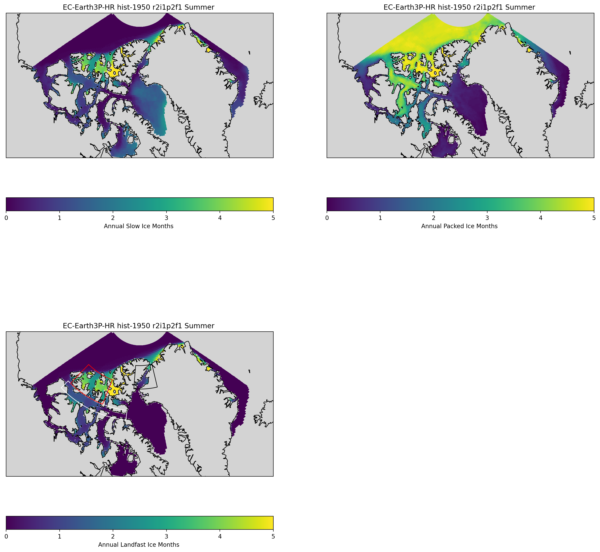

```console
Model: EC-Earth3P-HR, variant r3i1p2f1
	Now plotting sislow
	Now plotting sipacked
	Now plotting silandfast
```
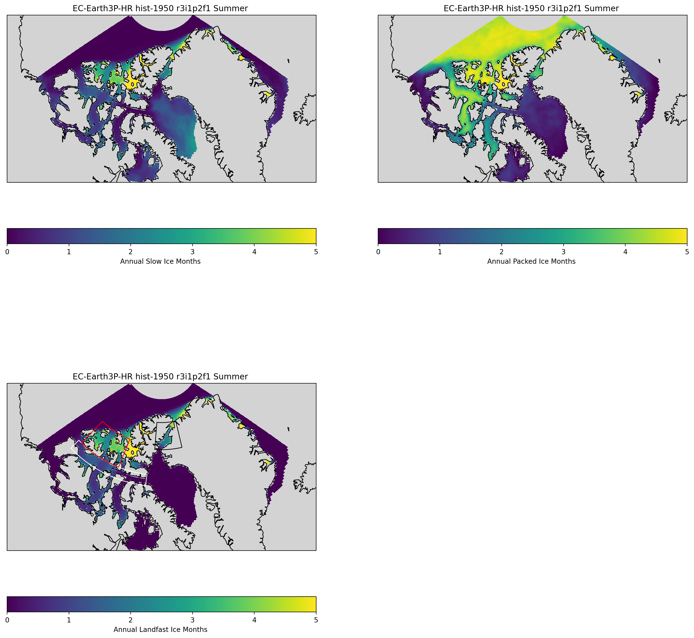

```console
Model: HadGEM3-GC31-MM, variant r1i1p1f1
	Now plotting sislow
	Now plotting sipacked
	Now plotting silandfast
```
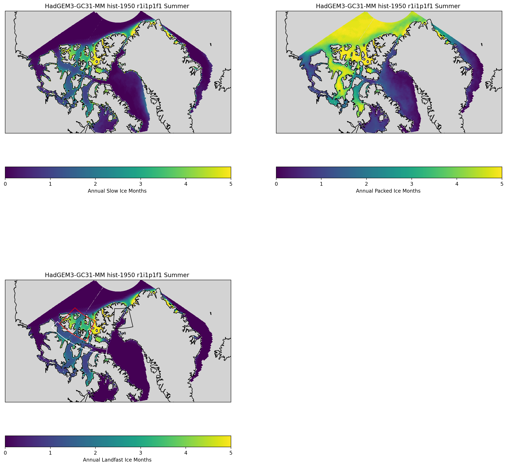

```console
Model: HadGEM3-GC31-MM, variant r1i2p1f1
	Now plotting sislow
	Now plotting sipacked
	Now plotting silandfast
```


```console
Model: HadGEM3-GC31-MM, variant r1i3p1f1
	Now plotting sislow
	Now plotting sipacked
	Now plotting silandfast
```
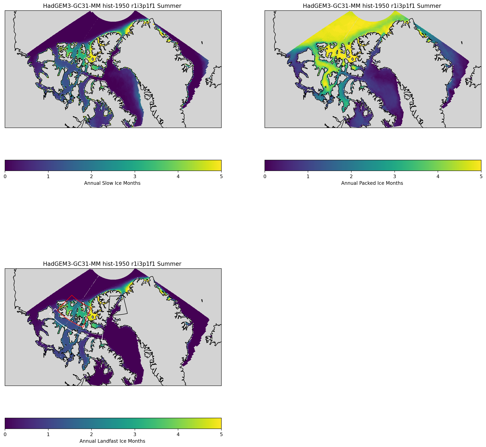

---

## Figures of trend maps
[back to top](#supplementary-figures)

### Variants of Figure 3 / 5
[back to top](#supplementary-figures)

The below figures are in the same fashion as Figure 3 / 5 in the main text, including subplots of trend maps (1950-2014) of sea ice thickness, speed, concentration, and concentration where sea ice thickness is greater than 2 meters.
The code below takes about 14 minutes to run on my laptop.
```python
from matplotlib import pyplot as plt
import numpy as np
import xarray as xr

from arctichoke.analysis import sum_by_year 
from arctichoke.dataset import make_mask, select_months
from arctichoke.dataset.clim_mask import make_clim_mask
import arctichoke.params as sps
from arctichoke.params import sea_ice_vars
from arctichoke.path import list_variable_files
from arctichoke.plot import make_trend_map

this_experiment = 'hist-1950'
this_modification = 'trim_CAA_'
set_summer = True
set_verbose = False

fig_dicts = [
    {
        'this_model': 'EC-Earth3P-HR',
        'variant_labels': [
            # 'r1i1p2f1', 
            # 'r2i1p2f1', 
            'r3i1p2f1',
        ],
        'clim_mask_si_var': 'siconc',
        'si_vars': [
            'sithick',
            'sispeed',
            'siconc',
            'si2mthick',
        ],
    },
    {
        'this_model': 'HadGEM3-GC31-MM',
        'variant_labels': [
            'r1i1p1f1', 
            'r1i2p1f1', 
            'r1i3p1f1',
        ],
        'clim_mask_si_var': 'siconc2',
        'si_vars': [
            'sithick',
            'sispeed',
            'siconc2',
            'si2mthick',
        ],
    },
]

for fig_dict in fig_dicts:
    this_model = fig_dict['this_model']

    for variant_label in fig_dict['variant_labels']:
        print(f"Model: {this_model}, variant {variant_label}")
        # Create the sea ice mask
        clim_mask_dataset = make_clim_mask(
            this_source_id = this_model,
            this_experiment = this_experiment,
            this_var = fig_dict['clim_mask_si_var'],
            this_variant_label = variant_label,
            this_modification = this_modification,
            verbose = set_verbose
        )

        # Set up Figure
        plt.rcParams["figure.figsize"] = [18, 18]
        rows = 2
        cols = 2
        fig, axs = plt.subplots(rows, cols, squeeze=False)
        i = 0
        for variable_id in fig_dict['si_vars']:
            print(f"\tNow plotting {variable_id}")
            # Select the correct axis
            this_row = i//cols
            this_col = i%cols
            this_ax = axs[this_row, this_col]
            # Check whether to mask to just where ice is greater than 2 meters
            if variable_id == 'si2mthick':
                ## Make a mask based on summer average sea ice thickness
                # Get the files
                sithick_filelist = list_variable_files(
                    source_id = this_model,
                    variable_id = 'sithick',
                    variant_label = variant_label,
                    with_modification = this_modification,
                    verbose = set_verbose,
                )
                if set_summer:
                    # Select just the summer months
                    sithick_dataset = select_months(
                        sithick_filelist,
                        verbose = set_verbose,
                    )
                else:
                    sithick_dataset = xr.open_mfdataset(sithick_filelist)
                # Take the yearly average
                sithick_dataset = sum_by_year(
                    sithick_dataset,
                    find_mean = True,
                    verbose = set_verbose,
                )
                # Get the maximum possible integer to cover all reasonable values of `sithick`
                numpy_int32_max = np.iinfo(np.int32).max
                # Make the mask of sea ice thicker than 2 meters
                si2mthick_var = 'si2mthick_year_mean'
                sithick_dataset = make_mask(
                    sithick_dataset,
                    var = 'sithick_year_mean',
                    mask_var_name = si2mthick_var,
                    mask_this_range = [2, numpy_int32_max],
                    val_inside_range = 1,
                    val_outside_range = 0,
                    add_mask_attrs = True,
                    verbose = set_verbose,
                )
                # Copy the variable attributes
                keep_these_attrs = sithick_dataset[si2mthick_var].attrs
                # Apply the sea ice mask
                sithick_dataset[si2mthick_var] = sithick_dataset[si2mthick_var] * clim_mask_dataset[f'{fig_dict['clim_mask_si_var']}_clim_mask']
                # Put the variable attributes back
                sithick_dataset[si2mthick_var].attrs = keep_these_attrs
                # Find the sum of the years of sea ice over 2 meters thick
                sithick_dataset_sum = sithick_dataset.sum(dim='year', min_count=1)
                sithick_dataset_sum[si2mthick_var].attrs['long_name'] = "Number of years with sea ice thickness > 2 m"
                sithick_dataset_sum[si2mthick_var].attrs['units'] = "yr"
                # Reset the variables to use in `make_trend_map`
                variable_id = fig_dict['clim_mask_si_var']
                use_this_mask = sithick_dataset[si2mthick_var]
                this_map_label = 'Trend in Yearly mean Conc. (thickness > 2 m) (%/yr)'
            else:
                use_this_mask = clim_mask_dataset[f'{fig_dict['clim_mask_si_var']}_clim_mask']
                this_map_label = None
            # Plot the trend map
            this_map = make_trend_map(
                this_source_id = this_model,
                this_var = variable_id,
                this_variant_label = variant_label, 
                this_modification = this_modification,
                mask_where_zero_across_time = use_this_mask,
                select_summer = set_summer,
                call_sum_by_year = True,
                use_hvplot = False,
                trim_to_bbox = sps.CAA_BBOX,
                zoom_out_bbox = False,
                fig = fig,
                axis = this_ax,
                time_dim = 'time',
                find_mean = True,
                clims = sea_ice_vars[variable_id]['trend_clims'],
                return_map = True,
                map_label = this_map_label,
                verbose = set_verbose,
            )
            i += 1

        # Save the plot to file
        plt.savefig(f"docs/docs_results/supplementary_figures-img/Figure_3_{this_model}_{variant_label}.png", dpi=200, bbox_inches='tight')

        plt.show()
```
```console
Model: EC-Earth3P-HR, variant r3i1p2f1
	Now plotting sithick
	Now plotting sispeed
	Now plotting siconc
	Now plotting si2mthick
```
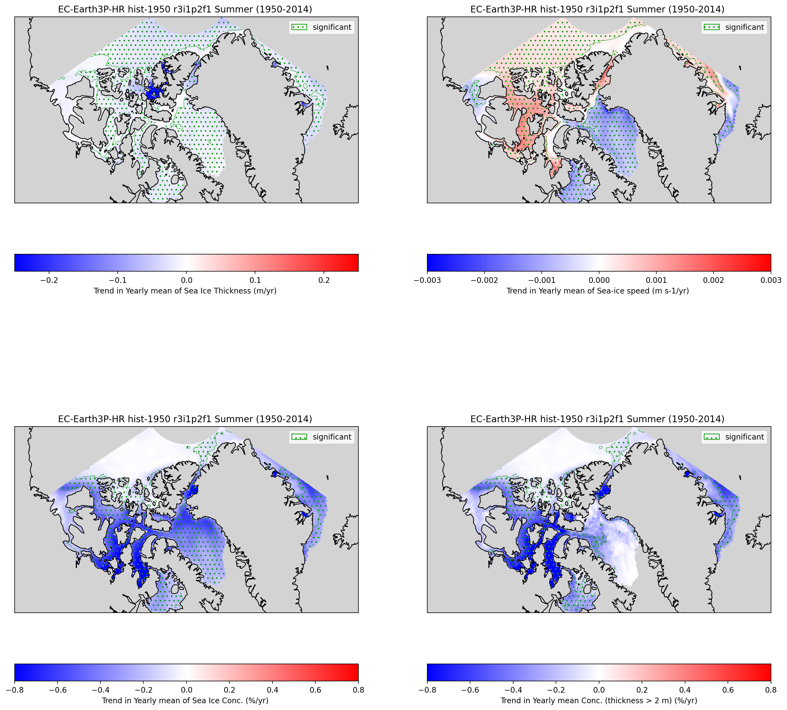

```console
Model: HadGEM3-GC31-MM, variant r1i1p1f1
	Now plotting sithick
	Now plotting sispeed
	Now plotting siconc2
	Now plotting si2mthick
```
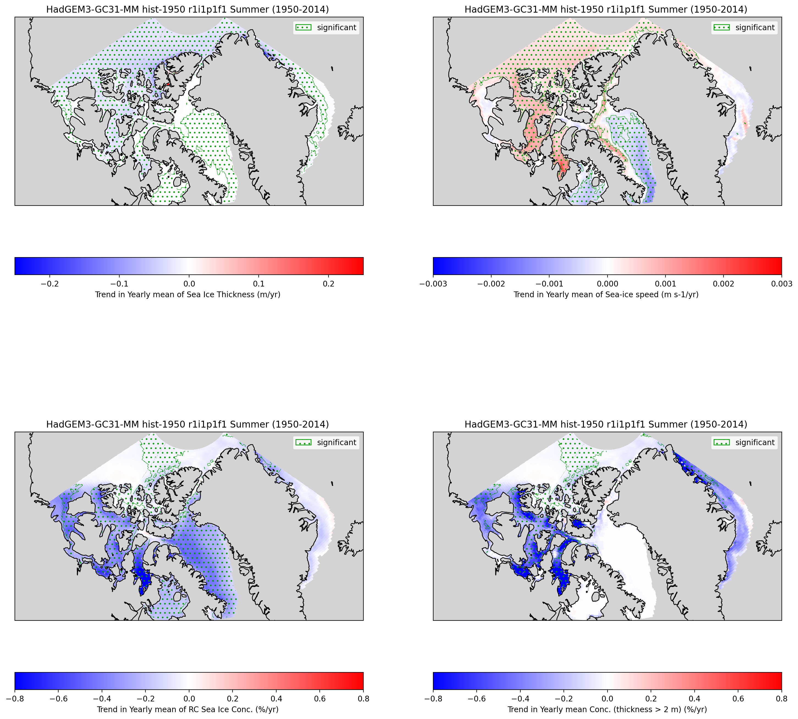

```console
Model: HadGEM3-GC31-MM, variant r1i2p1f1
	Now plotting sithick
	Now plotting sispeed
	Now plotting siconc2
	Now plotting si2mthick
```
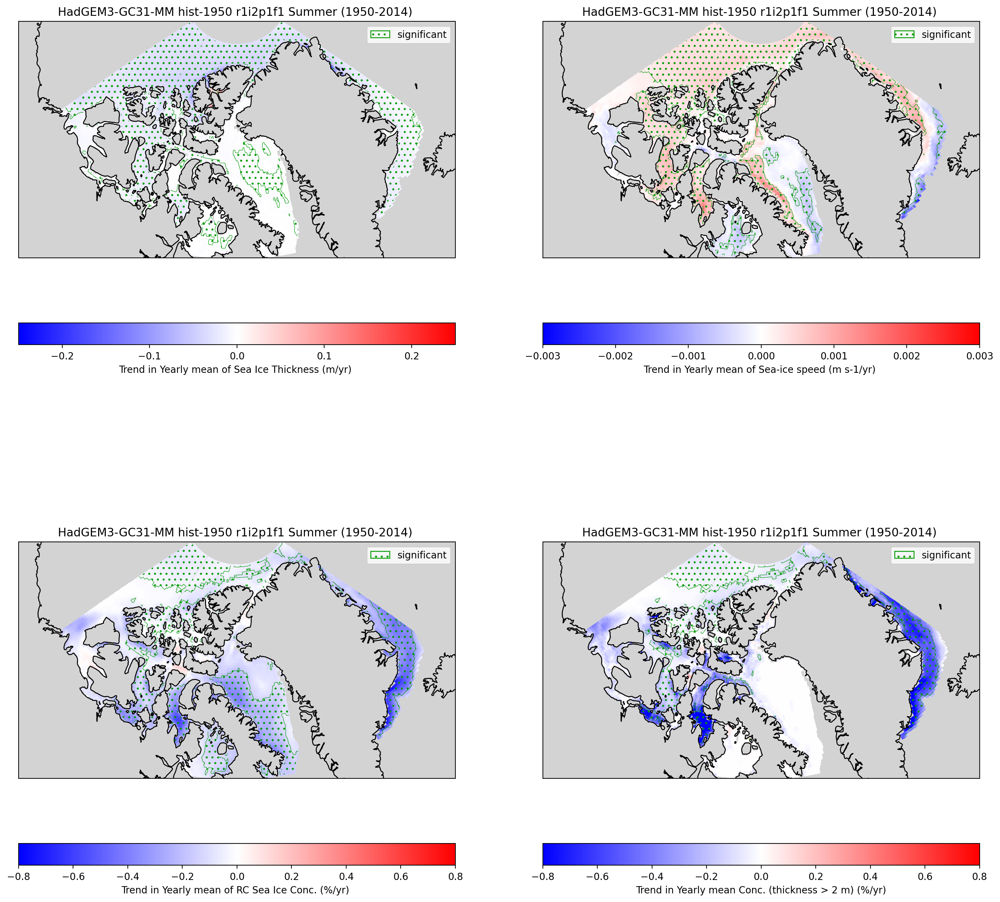

```console
Model: HadGEM3-GC31-MM, variant r1i3p1f1
	Now plotting sithick
	Now plotting sispeed
	Now plotting siconc2
	Now plotting si2mthick
```
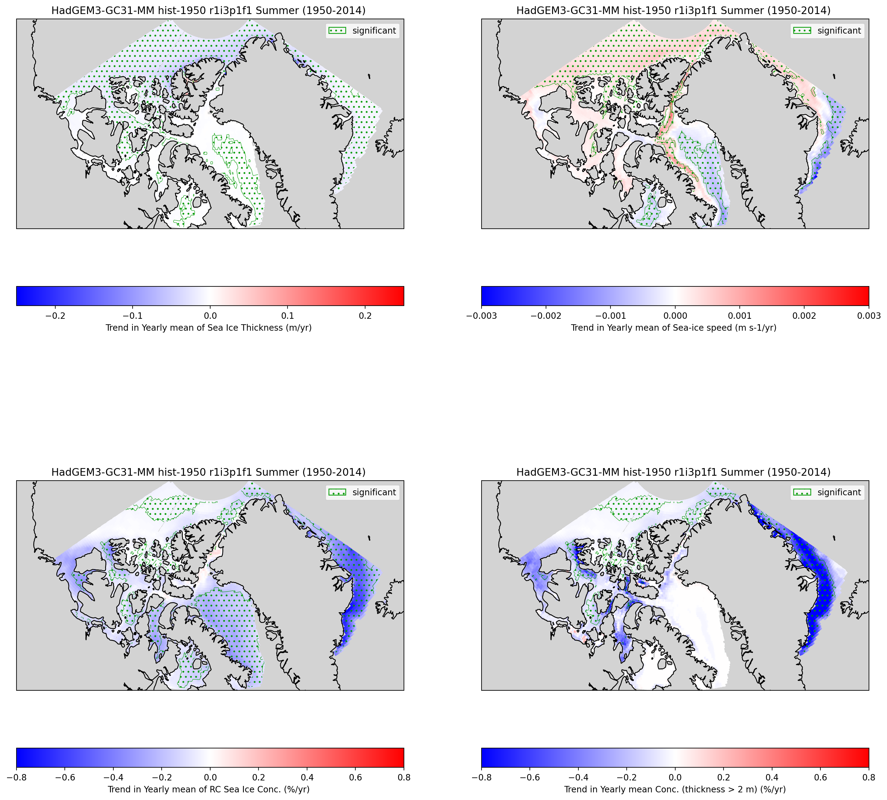

### Variants of Figure 4 / 6
[back to top](#supplementary-figures)

The below figures are in the same fashion as Figure 4 / 6 in the main text, including subplots of trend maps (1950-2014) of slow ice, packed ice, landfast ice, landfast ice using the climatology of slow ice, and landfast ice using the climatology of packed ice.
The code below takes about 17 minutes to run on my laptop.
```python
from matplotlib import pyplot as plt
import numpy as np
import xarray as xr

from arctichoke.analysis import sum_by_year 
from arctichoke.dataset import make_mask, select_months
from arctichoke.dataset.clim_mask import make_clim_mask
import arctichoke.params as sps
from arctichoke.params import sea_ice_vars
from arctichoke.path import list_variable_files
from arctichoke.plot import make_trend_map

this_experiment = 'hist-1950'
this_modification = 'trim_CAA_'
set_verbose = False

fig_dicts = [
    {
        'this_model': 'EC-Earth3P-HR',
        'variant_labels': [
            # 'r1i1p2f1', 
            # 'r2i1p2f1', 
            'r3i1p2f1',
        ],
        'clim_mask_si_var': 'siconc',
        'si_vars': [
            'sislow',
            'sipacked',
            'silandfast',
        ],
    },
    {
        'this_model': 'HadGEM3-GC31-MM',
        'variant_labels': [
            'r1i1p1f1', 
            'r1i2p1f1', 
            'r1i3p1f1',
        ],
        'clim_mask_si_var': 'siconc2',
        'si_vars': [
            'sislow',
            'sipacked',
            'silandfast',
        ],
    },
]

for fig_dict in fig_dicts:
    this_model = fig_dict['this_model']

    for variant_label in fig_dict['variant_labels']:
        print(f"Model: {this_model}, variant {variant_label}")
        # Create the sea ice mask
        clim_mask_dataset = make_clim_mask(
            this_source_id = this_model,
            this_experiment = this_experiment,
            this_var = fig_dict['clim_mask_si_var'],
            this_variant_label = variant_label,
            this_modification = this_modification,
            verbose = set_verbose
        )

        # Set up Figure
        plt.rcParams["figure.figsize"] = [18, 24]
        rows = 3
        cols = 2
        fig, axs = plt.subplots(rows, cols, squeeze=False)
        i = 0
        for variable_id in [
            'sislow',
            'sipacked',
        ]:
            print(f"\tNow plotting {variable_id}")
            # Select the correct axis
            this_row = i//cols
            this_col = i%cols
            this_ax = axs[this_row, this_col]
            # Plot the trend map
            this_map = make_trend_map(
                this_source_id = this_model,
                this_var = variable_id,
                this_variant_label = variant_label,
                this_modification = 'trim_CAA_',
                mask_where_zero_across_time = clim_mask_dataset[f'{fig_dict['clim_mask_si_var']}_clim_mask'],
                select_summer = True,
                use_hvplot = False,
                zoom_out_bbox = False,
                trim_to_bbox = sps.CAA_BBOX,
                fig = fig,
                axis = this_ax,
                contour_level = 0.5,
                clims = sea_ice_vars[variable_id]['trend_clims'],
                return_map = True,
                verbose = set_verbose,
            )
            i += 1
        # Remove the unneeded axis
        # Select the correct axis
        this_row = i//cols
        this_col = i%cols
        axs[this_row, this_col].remove()
        i += 1
        for this_version_id in [
            'v20260617',
            'with_siconc_clim',
            'with_sispeed_clim',
        ]:
            print(f"\tNow plotting silandfast for {this_version_id}")
            # Select the correct axis
            this_row = i//cols
            this_col = i%cols
            this_ax = axs[this_row, this_col]
            # Plot the trend map
            this_map = make_trend_map(
                this_source_id = this_model,
                this_var = 'silandfast',
                this_variant_label = variant_label,
                this_modification = 'trim_CAA_',
                mask_where_zero_across_time = True,
                version_id = this_version_id,
                select_summer = True,
                use_hvplot = False,
                zoom_out_bbox = False,
                trim_to_bbox = sps.CAA_BBOX,
                fig = fig,
                axis = this_ax,
                clims = sea_ice_vars['silandfast']['trend_clims'],
                add_sig = True,
                return_map = True,
                verbose = set_verbose,
            )
            i += 1

        # Save the plot to file
        plt.savefig(f"docs/docs_results/supplementary_figures-img/Figure_4_{this_model}_{variant_label}.png", dpi=200, bbox_inches='tight')

        plt.show()
```
```console
Model: EC-Earth3P-HR, variant r3i1p2f1
    Now plotting sislow
    Now plotting sipacked
	Now plotting silandfast for v20260617
	Now plotting silandfast for with_siconc_clim
	Now plotting silandfast for with_sispeed_clim
```
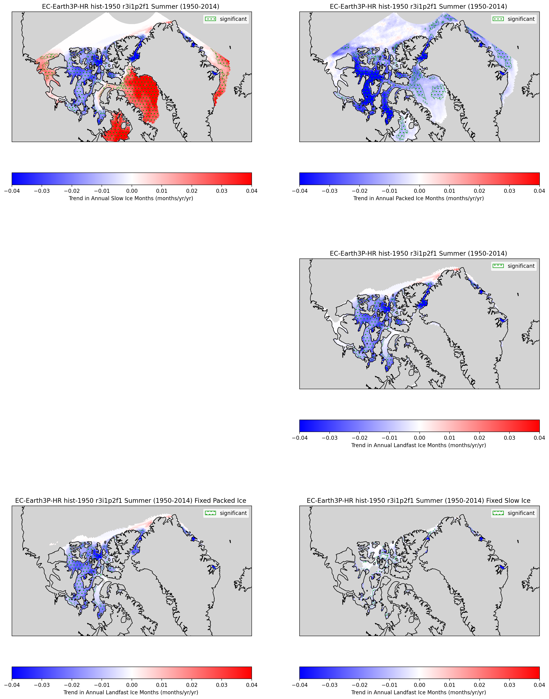

```console
Model: HadGEM3-GC31-MM, variant r1i1p1f1
    Now plotting sislow
    Now plotting sipacked
	Now plotting silandfast for v20260617
	Now plotting silandfast for with_siconc_clim
	Now plotting silandfast for with_sispeed_clim
```
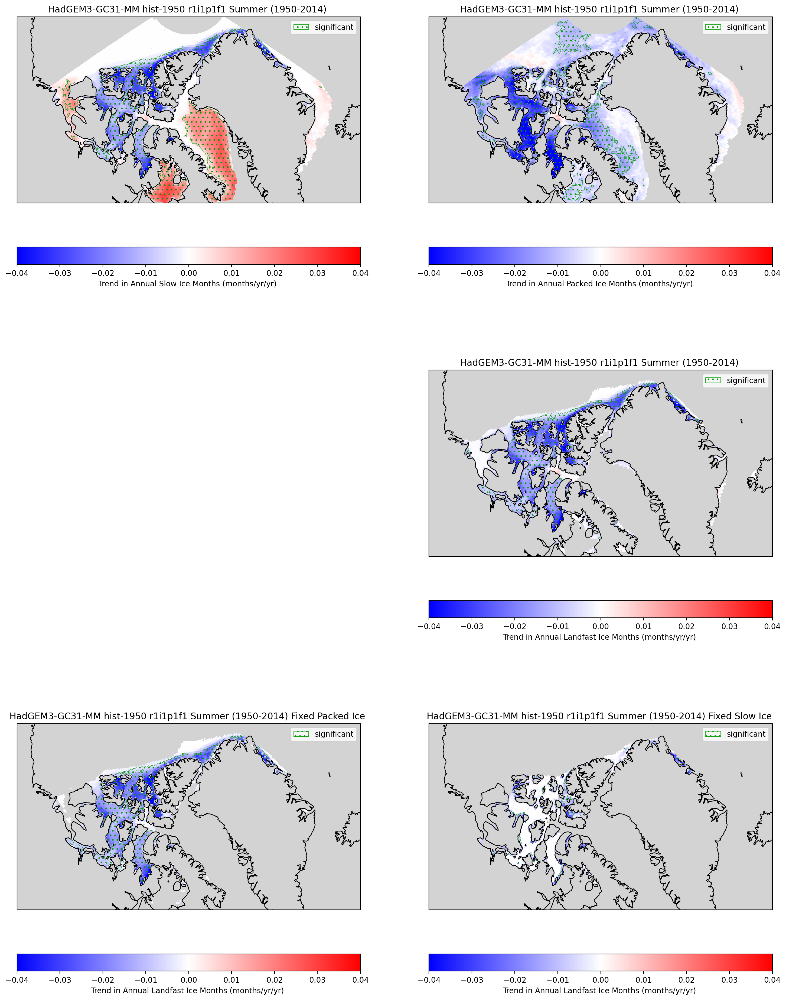

```console
Model: HadGEM3-GC31-MM, variant r1i2p1f1
    Now plotting sislow
    Now plotting sipacked
	Now plotting silandfast for v20260617
	Now plotting silandfast for with_siconc_clim
	Now plotting silandfast for with_sispeed_clim
```
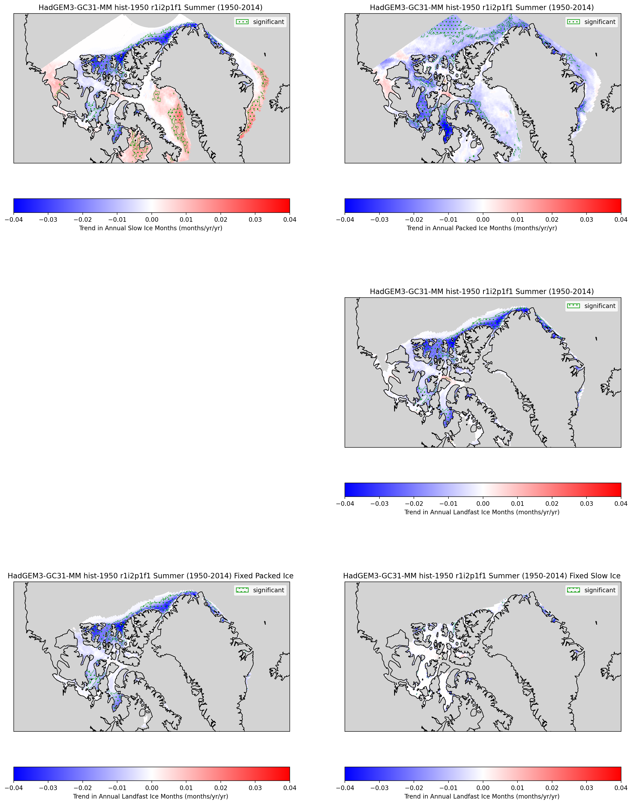

```console
Model: HadGEM3-GC31-MM, variant r1i3p1f1
    Now plotting sislow
    Now plotting sipacked
	Now plotting silandfast for v20260617
	Now plotting silandfast for with_siconc_clim
	Now plotting silandfast for with_sispeed_clim
```
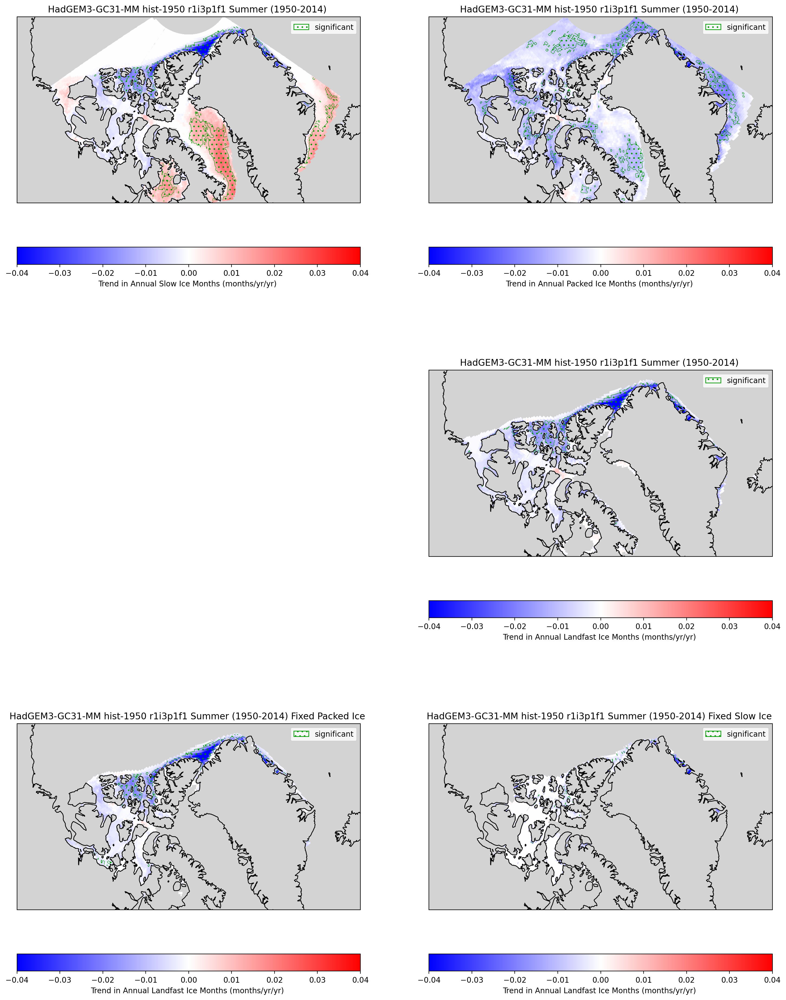

---

## Figures of monthly time series for specific regions
[back to top](#supplementary-figures)

### Variants of Figure 7
[back to top](#supplementary-figures)

The below figures are in the same fashion as Figure 7 in the main text, including subplots with time series (1950-1969) of sea ice speed, concentration, and landfast ice.
```python
import matplotlib.pyplot as plt

from arctichoke.plot.time_series_multi import plot_multi_time_series

this_modification = 'trim_QW_'
set_verbose = False

fig_dicts = [
    {
        'this_model': 'EC-Earth3P-HR',
        'si_vars': [
            'sispeed',
            'siconc',
        ],
        'si_landfast_variants': [
            'v20260617',
            # 'with_sispeed_clim',
            # 'with_siconc_clim',
        ],
    },
    {
        'this_model': 'HadGEM3-GC31-MM',
        'si_vars': [
            'sispeed',
            'siconc2',
        ],
        'si_landfast_variants': [
            'v20260617',
            # 'with_sispeed_clim',
            # 'with_siconc_clim',
        ],
    },
]

for this_modification in [
    'trim_QW_',
    'trim_PC_',
    'trim_NS_',
]:
    print(f"Region: {this_modification}")
    for fig_dict in fig_dicts:
        this_model = fig_dict['this_model']
        print(f"\tModel: {this_model}")
        x_limits = ['1949-12-12', '1970-01-01']

        # Set up Figure
        plt.rcParams["figure.figsize"] = [12, 11]
        rows = 3
        cols = 1
        fig, axs = plt.subplots(rows, cols, squeeze=False)

        i = 0
        # Only include title and legend on the first axis
        time_series_title = None
        add_legend = True
        for variable_id in fig_dict['si_vars']:
            print(f"\t\tvariable_id: {variable_id}")
            # Select the correct axis
            this_row = i//cols
            this_col = i%cols
            this_ax = axs[this_row, this_col]
            # Plot the time series
            plot_axis = plot_multi_time_series(
                this_source_id = this_model,
                this_var = variable_id,
                this_modification = this_modification,
                add_regression = False,
                call_sum_by_year = False,
                select_summer = False,
                plt_title = time_series_title,
                include_legend = add_legend,
                xlims = x_limits,
                fig = fig,
                axis = this_ax,
                verbose = set_verbose,
            )
            # Only include title and legend on the first axis
            time_series_title = ''
            add_legend = False
            i += 1

        for this_version_id in fig_dict['si_landfast_variants']:
            print(f"\t\tvariable id: silandfast for {this_version_id}")
            # Select the correct axis
            this_row = i//cols
            this_col = i%cols
            this_ax = axs[this_row, this_col]
            # Plot the time series
            plot_axis = plot_multi_time_series(
                this_source_id = this_model,
                this_var = 'silandfast',
                this_modification = this_modification,
                this_version_id = this_version_id,
                add_regression = False,
                call_sum_by_year = False,
                select_summer = False,
                plt_title = time_series_title,
                include_legend = add_legend,
                xlims = x_limits,
                fig = fig,
                axis = this_ax,
                verbose = set_verbose,
            )
            # Only include title and legend on the first axis
            time_series_title = ''
            add_legend = False
            i += 1

            # Save the plot to file
            plt.savefig(f"docs/docs_results/supplementary_figures-img/Figure_7_{this_modification}_{this_model}.png", dpi=200, bbox_inches='tight')

            plt.show()
```
```console
Region: trim_QW_
	Model: EC-Earth3P-HR
		variable_id: sispeed
		variable_id: siconc
		variable id: silandfast for v20260617
```
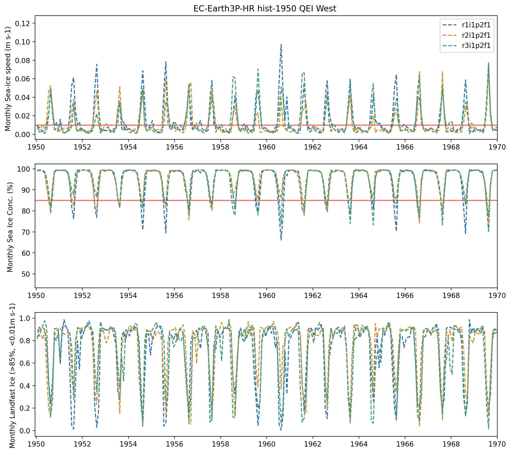
```console
	Model: HadGEM3-GC31-MM
		variable_id: sispeed
		variable_id: siconc2
		variable id: silandfast for v20260617
```
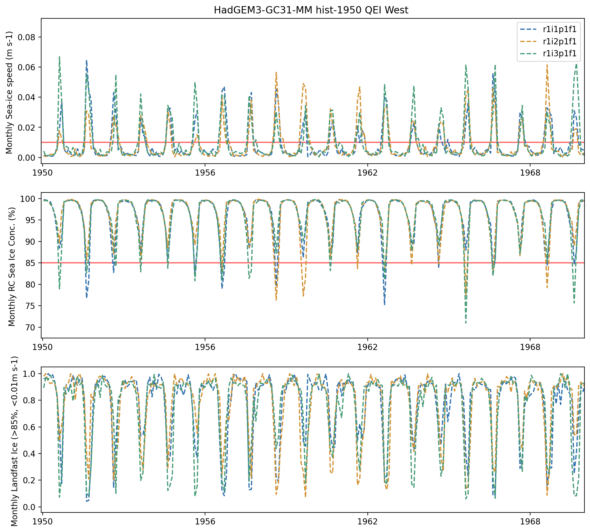
```console
Region: trim_PC_
	Model: EC-Earth3P-HR
		variable_id: sispeed
		variable_id: siconc
		variable id: silandfast for v20260617
```
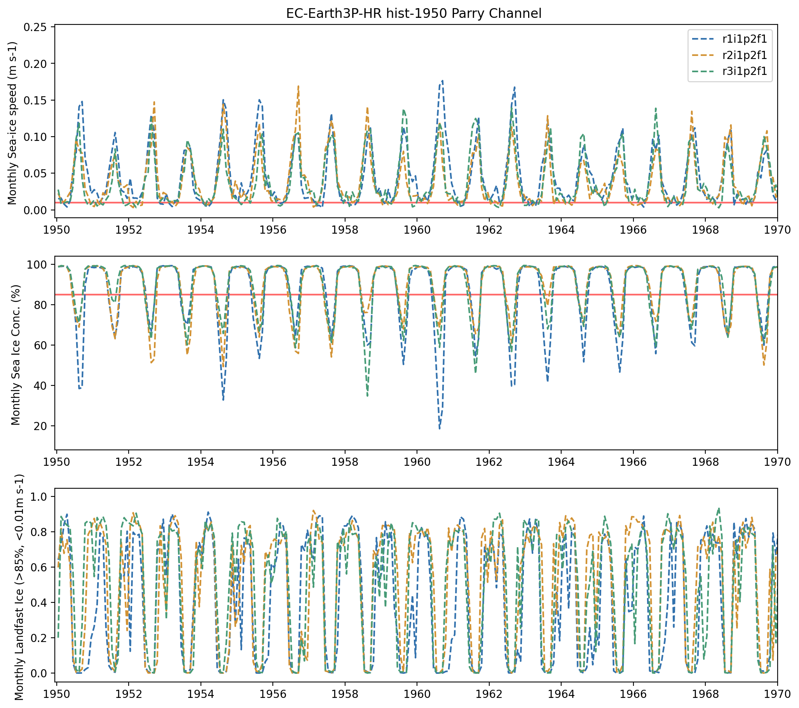
```console
	Model: HadGEM3-GC31-MM
		variable_id: sispeed
		variable_id: siconc2
		variable id: silandfast for v20260617
```
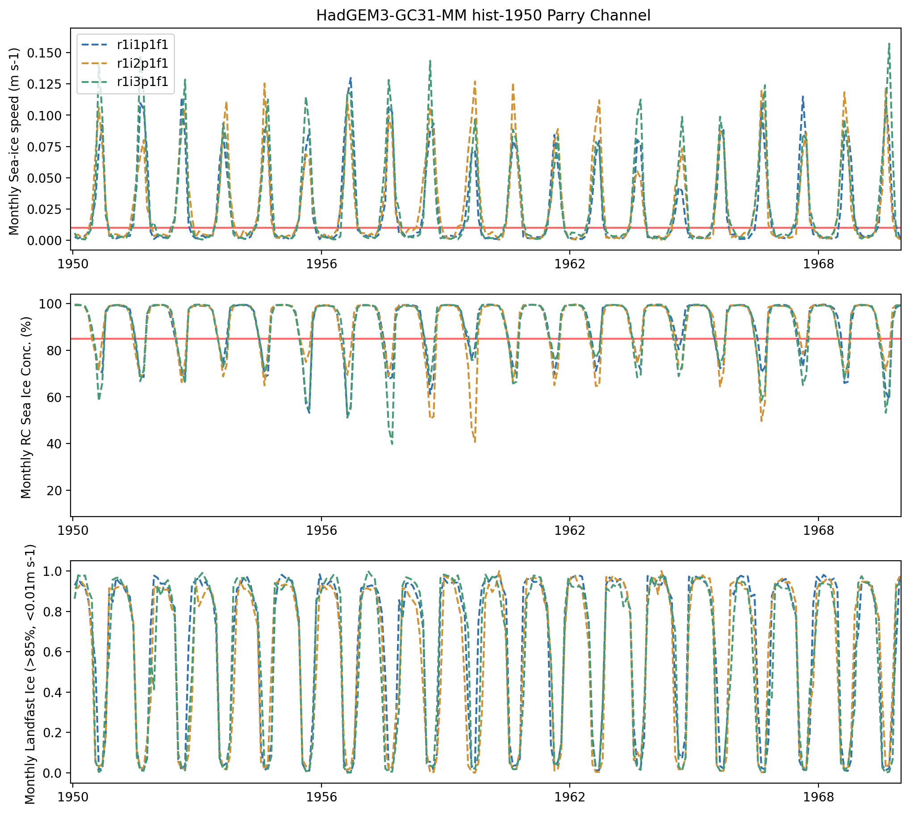
```console
Region: trim_NS_
	Model: EC-Earth3P-HR
		variable_id: sispeed
		variable_id: siconc
		variable id: silandfast for v20260617
```
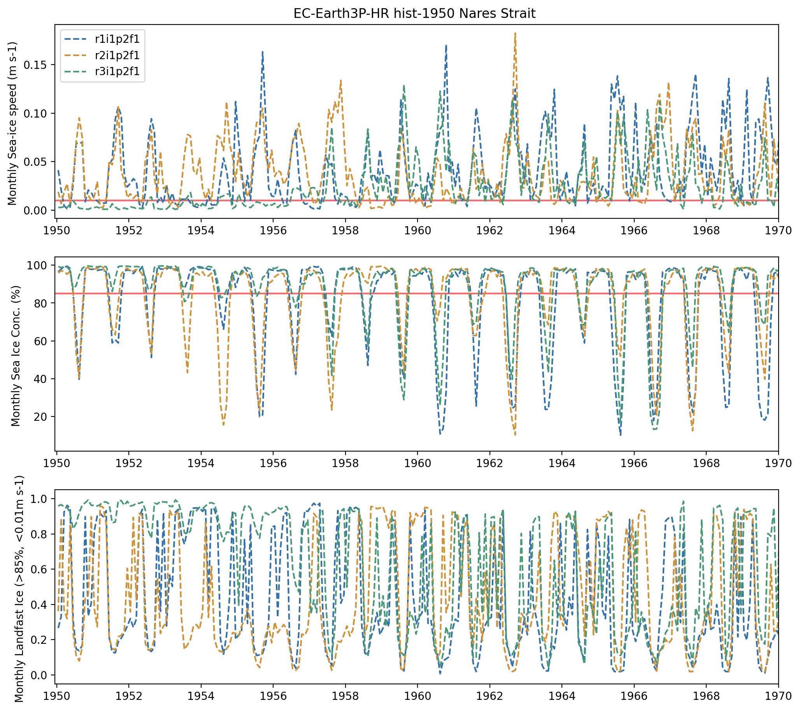
```console
	Model: HadGEM3-GC31-MM
		variable_id: sispeed
		variable_id: siconc2
		variable id: silandfast for v20260617
```
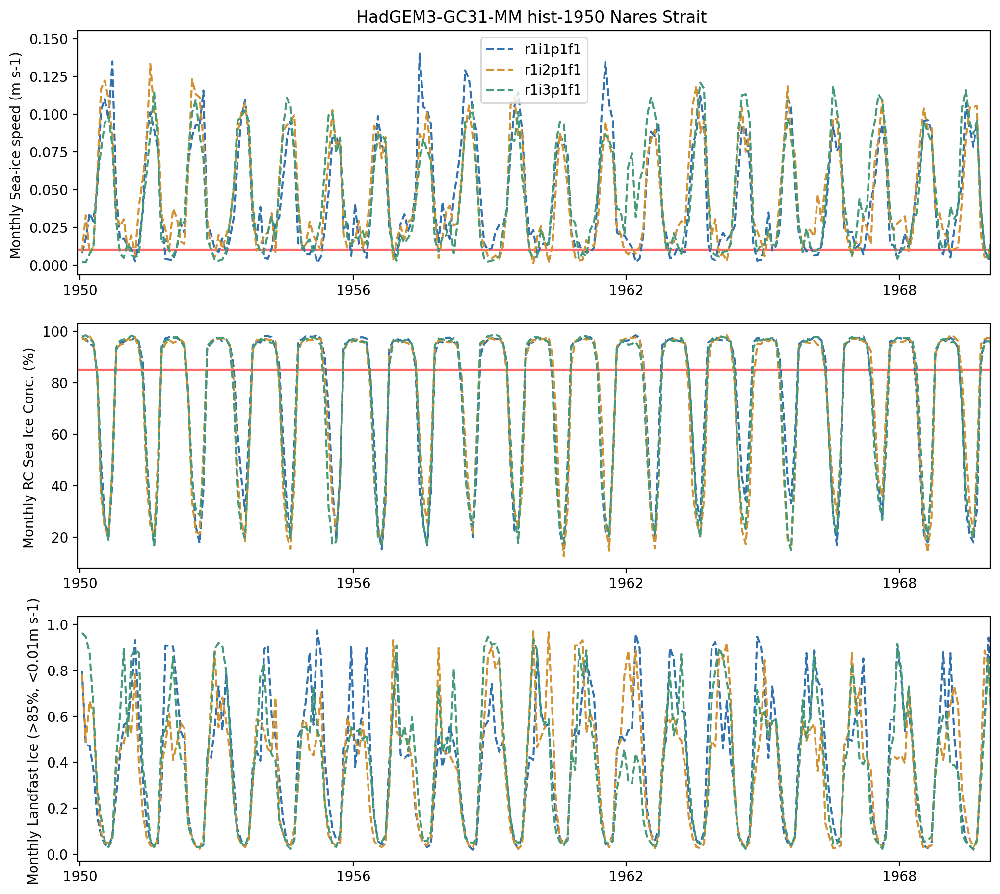

---

## Figures of trends in specific regions
[back to top](#supplementary-figures)

The next few figures show time series of particular variables for the three specific regions defined in the paper, QEI West, Parry Channel, and Nares Strait, all for `HadGEM3-GC31-MM`.
I chose to not produce regional maps using `hvplot` for these figures.

### Variant of Figure 8
[back to top](#supplementary-figures)

The below figure is in the same fashion as Figure 8 in the main text, using data from `HadGEM3-GC31-MM` instead of `EC-Earth3P-HR`.
The code below takes about 4 minutes to run on my laptop.
```python
import matplotlib.pyplot as plt

from arctichoke.plot.time_series_multi import plot_multi_time_series

# Set up Figure
plt.rcParams["figure.figsize"] = [24, 12]
rows = 2
cols = 3
fig, axs = plt.subplots(rows, cols, squeeze=False)

this_model = 'HadGEM3-GC31-MM'
this_modification = 'trim_QW_'
aggregate_yearly = True
only_summer = True
set_verbose = False

# Plot a map of the landfast ice climatology for this region
if True:
    from arctichoke.dataset import select_months, trim_latlon
    from arctichoke.dataset.interp_dataset import interp_to_reg_grid
    from arctichoke.path import list_variable_files
    from arctichoke.params import QW_BBOX
    from arctichoke.plot import plot_map
    variant_label = 'r1i1p1f1'
    print(f'Now plotting map of {variant_label}')
    this_si_var = 'silandfast'
    # Get the relevant file path
    sivar_clim_file = list_variable_files(
        source_id = this_model,
        variable_id = f'{this_si_var}_month_mean',
        experiment_id = 'hist-1950',
        variant_label = variant_label,
        with_modification = 'trim_CAA_',
        verbose = set_verbose,
    )
    # Select just the summer months
    dataset_clim = select_months(sivar_clim_file, time_dim='month')
    # Trim to this specific area
    dataset_clim = trim_latlon(
        dataset = dataset_clim,
        map_bbox = QW_BBOX,
        precise_trim = True,
        verbose = set_verbose,
    )
    # Take the sum across the 12 months
    dataset_clim = dataset_clim.sum(dim='month', min_count=1)
    # Adjust the `long_name` attribute to change the colorbar label
    dataset_clim[f'{this_si_var}_month_mean'].attrs['long_name'] = dataset_clim[f'{this_si_var}_month_mean'].attrs['long_name'].replace('onthly m', '')
    # Interpolate the data
    dataset_interp = interp_to_reg_grid(
        dataset = dataset_clim,
        targetgrid = 'data/target_grid_1-16_deg.nc',
        trim_to_bbox = QW_BBOX,
        verbose = set_verbose,
    )
    # Plot the data on a map
    this_map, plot_map_kwargs = plot_map(
        dataset_interp,
        f'{this_si_var}_month_mean',
        fig = fig,
        axis = axs[0,0],
        clims = [0,5],
        map_bbox = QW_BBOX,
        mark_bbox = True,
        use_hvplot = False,
        return_plot_map_kwargs = True,
        verbose = set_verbose,
    )

# Skip the first axis
i = 1
# Only include legend on the first axis
add_legend = True
for variable_id in [
    'sispeed',
    'siconc2',
    # 'sislow',
    # 'sipacked',
]:
    # Select the correct axis
    this_row = i//cols
    this_col = i%cols
    this_ax = axs[this_row, this_col]
    if 'siconc' in variable_id:
        print(f"variable_id: {variable_id} where sithick is > 2m")
        # Plot the time series for sea ice concentration for thick ice
        plot_axis = plot_multi_time_series(
            this_source_id = this_model,
            this_var = variable_id,
            this_modification = this_modification,
            mask_by_sithick = True,
            call_sum_by_year = aggregate_yearly,
            select_summer = only_summer,
            include_legend = add_legend,
            fig = fig,
            axis = this_ax,
            verbose = set_verbose,
        )
    else:
        print(f"\nvariable_id: {variable_id}")
        # Plot the time series
        plot_axis = plot_multi_time_series(
            this_source_id = this_model,
            this_var = variable_id,
            this_modification = this_modification,
            call_sum_by_year = aggregate_yearly,
            select_summer = only_summer,
            include_legend = add_legend,
            fig = fig,
            axis = this_ax,
            verbose = set_verbose,
        )
    # Only include legend on the first axis
    add_legend = False
    i += 1

for this_version_id in [
    'v20260617',
    'with_siconc_clim',
    'with_sispeed_clim',
]:
    print(f'\nvariable id: silandfast for {this_version_id}')
    # Select the correct axis
    this_row = i//cols
    this_col = i%cols
    this_ax = axs[this_row, this_col]
    # Plot the time series
    plot_axis = plot_multi_time_series(
        this_source_id = this_model,
        this_var = 'silandfast',
        this_modification = this_modification,
        this_version_id = this_version_id,
        call_sum_by_year = aggregate_yearly,
        select_summer = only_summer,
        include_legend = add_legend,
        fig = fig,
        axis = this_ax,
        verbose = set_verbose,
    )
    # Only include legend on the first axis
    add_legend = False
    i += 1

# Save the plot to file
plt.savefig(f"docs/docs_results/supplementary_figures-img/Figure_8_{this_model}.png", dpi=200, bbox_inches='tight')

plt.show()
```
```console
Now plotting map of r1i1p1f1

variable_id: sispeed
(plot_time_series) Slope of `sispeed_year_mean` regression line:  2.90917e-04
(plot_time_series) Slope of `sispeed_year_mean` regression line:  2.14846e-04
(plot_time_series) Slope of `sispeed_year_mean` regression line:  1.33232e-04
variable_id: siconc2 where sithick is > 2m
(plot_time_series) Slope of `siconc2_si2mthick_year_mean` regression line: -8.98384e-02
(plot_time_series) Slope of `siconc2_si2mthick_year_mean` regression line: -5.23772e-02
(plot_time_series) Slope of `siconc2_si2mthick_year_mean` regression line: -4.43430e-02

variable id: silandfast for v20260617
(plot_time_series) Slope of `silandfast_year_sum` regression line: -2.14962e-02
(plot_time_series) Slope of `silandfast_year_sum` regression line: -1.71621e-02
(plot_time_series) Slope of `silandfast_year_sum` regression line: -1.05905e-02

variable id: silandfast for with_siconc_clim
(plot_time_series) Slope of `silandfast_year_sum` regression line: -1.67783e-02
(plot_time_series) Slope of `silandfast_year_sum` regression line: -1.40353e-02
(plot_time_series) Slope of `silandfast_year_sum` regression line: -8.29662e-03

variable id: silandfast for with_sispeed_clim
(plot_time_series) Slope of `silandfast_year_sum` regression line: -5.02672e-03
(plot_time_series) Slope of `silandfast_year_sum` regression line: -3.51461e-03
(plot_time_series) Slope of `silandfast_year_sum` regression line: -2.33698e-03
```
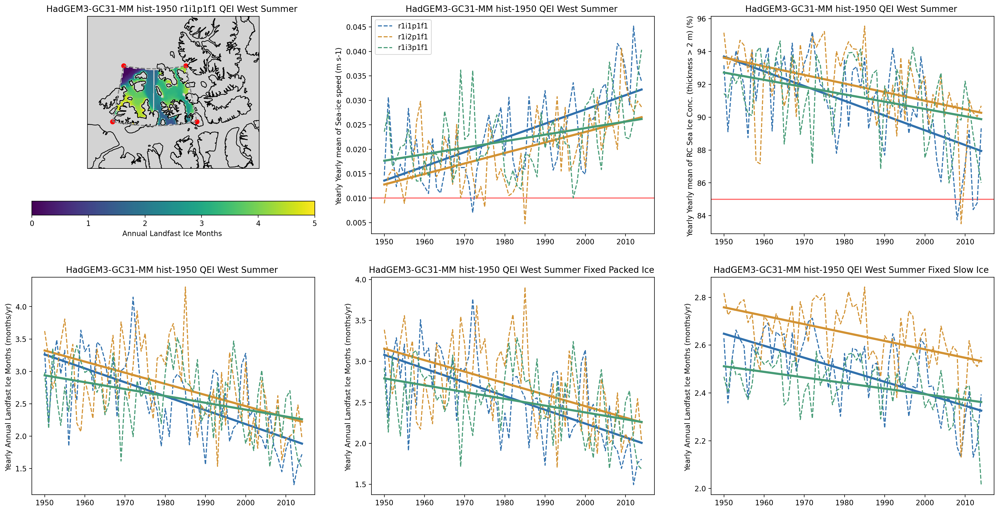

### Variant of Figure 9
[back to top](#supplementary-figures)

The below figure is in the same fashion as Figure 9 in the main text, using data from `HadGEM3-GC31-MM` instead of `EC-Earth3P-HR`.
The code below takes about 4 minutes to run on my laptop.
```python
import matplotlib.pyplot as plt

from arctichoke.plot.time_series_multi import plot_multi_time_series

# Set up Figure
plt.rcParams["figure.figsize"] = [24, 12]
rows = 2
cols = 3
fig, axs = plt.subplots(rows, cols, squeeze=False)

this_model = 'HadGEM3-GC31-MM'
this_modification = 'trim_PC_'
aggregate_yearly = True
only_summer = True
set_verbose = False

# Plot a map of the landfast ice climatology for this region
if True:
    from arctichoke.dataset import select_months, trim_latlon
    from arctichoke.dataset.interp_dataset import interp_to_reg_grid
    from arctichoke.path import list_variable_files
    from arctichoke.params import PC_BBOX
    from arctichoke.plot import plot_map
    variant_label = 'r1i1p1f1'
    print(f'Now plotting map of {variant_label}')
    this_si_var = 'silandfast'
    # Get the relevant file path
    sivar_clim_file = list_variable_files(
        source_id = this_model,
        variable_id = f'{this_si_var}_month_mean',
        experiment_id = 'hist-1950',
        variant_label = variant_label,
        with_modification = 'trim_CAA_',
        verbose = set_verbose,
    )
    # Select just the summer months
    dataset_clim = select_months(sivar_clim_file, time_dim='month')
    # Trim to this specific area
    dataset_clim = trim_latlon(
        dataset = dataset_clim,
        map_bbox = PC_BBOX,
        precise_trim = True,
        verbose = set_verbose,
    )
    # Take the sum across the 12 months
    dataset_clim = dataset_clim.sum(dim='month', min_count=1)
    # Adjust the `long_name` attribute to change the colorbar label
    dataset_clim[f'{this_si_var}_month_mean'].attrs['long_name'] = dataset_clim[f'{this_si_var}_month_mean'].attrs['long_name'].replace('onthly m', '')
    # Interpolate the data
    dataset_interp = interp_to_reg_grid(
        dataset = dataset_clim,
        targetgrid = 'data/target_grid_1-16_deg.nc',
        trim_to_bbox = PC_BBOX,
        verbose = set_verbose,
    )
    # Plot the data on a map
    this_map, plot_map_kwargs = plot_map(
        dataset_interp,
        f'{this_si_var}_month_mean',
        fig = fig,
        axis = axs[0,0],
        clims = [0,5],
        map_bbox = PC_BBOX,
        mark_bbox = True,
        use_hvplot = False,
        return_plot_map_kwargs = True,
        verbose = set_verbose,
    )

# Skip the first axis
i = 1
# Only include legend on the first axis
add_legend = True
for variable_id in [
    'sispeed',
    'siconc2',
    # 'sislow',
    # 'sipacked',
]:
    # Select the correct axis
    this_row = i//cols
    this_col = i%cols
    this_ax = axs[this_row, this_col]
    if 'siconc' in variable_id:
        print(f"variable_id: {variable_id} where sithick is > 2m")
        # Plot the time series for sea ice concentration for thick ice
        plot_axis = plot_multi_time_series(
            this_source_id = this_model,
            this_var = variable_id,
            this_modification = this_modification,
            mask_by_sithick = True,
            call_sum_by_year = aggregate_yearly,
            select_summer = only_summer,
            include_legend = add_legend,
            fig = fig,
            axis = this_ax,
            verbose = set_verbose,
        )
    else:
        print(f"\nvariable_id: {variable_id}")
        # Plot the time series
        plot_axis = plot_multi_time_series(
            this_source_id = this_model,
            this_var = variable_id,
            this_modification = this_modification,
            call_sum_by_year = aggregate_yearly,
            select_summer = only_summer,
            include_legend = add_legend,
            fig = fig,
            axis = this_ax,
            verbose = set_verbose,
        )
    # Only include legend on the first axis
    add_legend = False
    i += 1

for this_version_id in [
    'v20260617',
    'with_siconc_clim',
    'with_sispeed_clim',
]:
    print(f'\nvariable id: silandfast for {this_version_id}')
    # Select the correct axis
    this_row = i//cols
    this_col = i%cols
    this_ax = axs[this_row, this_col]
    # Plot the time series
    plot_axis = plot_multi_time_series(
        this_source_id = this_model,
        this_var = 'silandfast',
        this_modification = this_modification,
        this_version_id = this_version_id,
        call_sum_by_year = aggregate_yearly,
        select_summer = only_summer,
        include_legend = add_legend,
        fig = fig,
        axis = this_ax,
        verbose = set_verbose,
    )
    # Only include legend on the first axis
    add_legend = False
    i += 1

# Save the plot to file
plt.savefig(f"docs/docs_results/supplementary_figures-img/Figure_9_{this_model}.png", dpi=200, bbox_inches='tight')

plt.show()
```
```console
Now plotting map of r1i1p1f1

variable_id: sispeed
(plot_time_series) Slope of `sispeed_year_mean` regression line:  4.94116e-04
(plot_time_series) Slope of `sispeed_year_mean` regression line:  1.97457e-04
(plot_time_series) Slope of `sispeed_year_mean` regression line:  1.16132e-04
variable_id: siconc2 where sithick is > 2m
(plot_time_series) Slope of `siconc2_si2mthick_year_mean` regression line: -2.79901e-01
(plot_time_series) Slope of `siconc2_si2mthick_year_mean` regression line: -8.29012e-02
(plot_time_series) Slope of `siconc2_si2mthick_year_mean` regression line: -7.40043e-02

variable id: silandfast for v20260617
(plot_time_series) Slope of `silandfast_year_sum` regression line: -1.12843e-02
(plot_time_series) Slope of `silandfast_year_sum` regression line: -2.91749e-03
(plot_time_series) Slope of `silandfast_year_sum` regression line: -2.60937e-03

variable id: silandfast for with_siconc_clim
(plot_time_series) Slope of `silandfast_year_sum` regression line: -9.75152e-03
(plot_time_series) Slope of `silandfast_year_sum` regression line: -2.71984e-03
(plot_time_series) Slope of `silandfast_year_sum` regression line: -2.09174e-03

variable id: silandfast for with_sispeed_clim
(plot_time_series) Slope of `silandfast_year_sum` regression line: -2.35436e-03
(plot_time_series) Slope of `silandfast_year_sum` regression line: -4.30923e-04
(plot_time_series) Slope of `silandfast_year_sum` regression line: -6.63102e-04
```
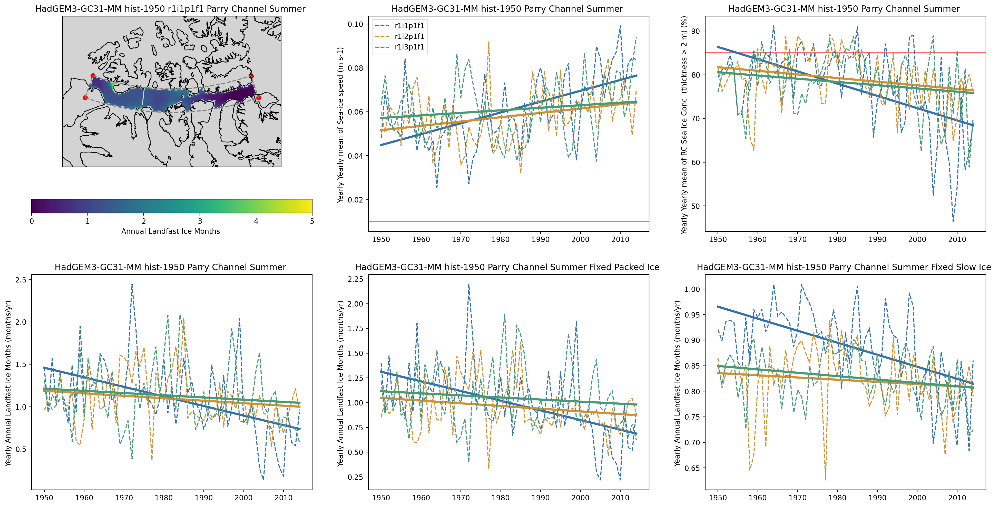

### Variant of Figure 10
[back to top](#supplementary-figures)

The below figure is in the same fashion as Figure 10 in the main text, using data from `HadGEM3-GC31-MM` instead of `EC-Earth3P-HR`.
The code below takes about 4 minutes to run on my laptop.
```python
import matplotlib.pyplot as plt

from arctichoke.plot.time_series_multi import plot_multi_time_series

# Set up Figure
plt.rcParams["figure.figsize"] = [24, 12]
rows = 2
cols = 3
fig, axs = plt.subplots(rows, cols, squeeze=False)

this_model = 'HadGEM3-GC31-MM'
this_modification = 'trim_NS_'
aggregate_yearly = True
only_summer = True
set_verbose = False

# Plot a map of the landfast ice climatology for this region
if True:
    from arctichoke.dataset import select_months, trim_latlon
    from arctichoke.dataset.interp_dataset import interp_to_reg_grid
    from arctichoke.path import list_variable_files
    from arctichoke.params import NS_BBOX
    from arctichoke.plot import plot_map
    variant_label = 'r1i1p1f1'
    print(f'Now plotting map of {variant_label}')
    this_si_var = 'silandfast'
    # Get the relevant file path
    sivar_clim_file = list_variable_files(
        source_id = this_model,
        variable_id = f'{this_si_var}_month_mean',
        experiment_id = 'hist-1950',
        variant_label = variant_label,
        with_modification = 'trim_CAA_',
        verbose = set_verbose,
    )
    # Select just the summer months
    dataset_clim = select_months(sivar_clim_file, time_dim='month')
    # Trim to this specific area
    dataset_clim = trim_latlon(
        dataset = dataset_clim,
        map_bbox = NS_BBOX,
        precise_trim = True,
        verbose = set_verbose,
    )
    # Take the sum across the 12 months
    dataset_clim = dataset_clim.sum(dim='month', min_count=1)
    # Adjust the `long_name` attribute to change the colorbar label
    dataset_clim[f'{this_si_var}_month_mean'].attrs['long_name'] = dataset_clim[f'{this_si_var}_month_mean'].attrs['long_name'].replace('onthly m', '')
    # Interpolate the data
    dataset_interp = interp_to_reg_grid(
        dataset = dataset_clim,
        targetgrid = 'data/target_grid_1-16_deg.nc',
        trim_to_bbox = NS_BBOX,
        verbose = set_verbose,
    )
    # Plot the data on a map
    this_map, plot_map_kwargs = plot_map(
        dataset_interp,
        f'{this_si_var}_month_mean',
        fig = fig,
        axis = axs[0,0],
        clims = [0,5],
        map_bbox = NS_BBOX,
        mark_bbox = True,
        use_hvplot = False,
        return_plot_map_kwargs = True,
        verbose = set_verbose,
    )

# Skip the first axis
i = 1
# Only include legend on the first axis
add_legend = True
for variable_id in [
    'sispeed',
    'siconc2',
    # 'sislow',
    # 'sipacked',
]:
    # Select the correct axis
    this_row = i//cols
    this_col = i%cols
    this_ax = axs[this_row, this_col]
    if 'siconc' in variable_id:
        print(f"variable_id: {variable_id} where sithick is > 2m")
        # Plot the time series for sea ice concentration for thick ice
        plot_axis = plot_multi_time_series(
            this_source_id = this_model,
            this_var = variable_id,
            this_modification = this_modification,
            mask_by_sithick = True,
            call_sum_by_year = aggregate_yearly,
            select_summer = only_summer,
            include_legend = add_legend,
            fig = fig,
            axis = this_ax,
            verbose = set_verbose,
        )
    else:
        print(f"\nvariable_id: {variable_id}")
        # Plot the time series
        plot_axis = plot_multi_time_series(
            this_source_id = this_model,
            this_var = variable_id,
            this_modification = this_modification,
            call_sum_by_year = aggregate_yearly,
            select_summer = only_summer,
            include_legend = add_legend,
            fig = fig,
            axis = this_ax,
            verbose = set_verbose,
        )
    # Only include legend on the first axis
    add_legend = False
    i += 1

for this_version_id in [
    'v20260617',
    'with_siconc_clim',
    'with_sispeed_clim',
]:
    print(f'\nvariable id: silandfast for {this_version_id}')
    # Select the correct axis
    this_row = i//cols
    this_col = i%cols
    this_ax = axs[this_row, this_col]
    # Plot the time series
    plot_axis = plot_multi_time_series(
        this_source_id = this_model,
        this_var = 'silandfast',
        this_modification = this_modification,
        this_version_id = this_version_id,
        call_sum_by_year = aggregate_yearly,
        select_summer = only_summer,
        include_legend = add_legend,
        fig = fig,
        axis = this_ax,
        verbose = set_verbose,
    )
    # Only include legend on the first axis
    add_legend = False
    i += 1

# Save the plot to file
plt.savefig(f"docs/docs_results/supplementary_figures-img/Figure_10_{this_model}.png", dpi=200, bbox_inches='tight')

plt.show()
```
```console
Now plotting map of r1i1p1f1

variable_id: sispeed
(plot_time_series) Slope of `sispeed_year_mean` regression line:  2.68859e-04
(plot_time_series) Slope of `sispeed_year_mean` regression line:  2.82197e-04
(plot_time_series) Slope of `sispeed_year_mean` regression line:  4.44678e-04
variable_id: siconc2 where sithick is > 2m
(plot_time_series) Slope of `siconc2_si2mthick_year_mean` regression line: -2.20039e-01
(plot_time_series) Slope of `siconc2_si2mthick_year_mean` regression line: -4.41596e-02
(plot_time_series) Slope of `siconc2_si2mthick_year_mean` regression line: -5.48348e-04

variable id: silandfast for v20260617
(plot_time_series) Slope of `silandfast_year_sum` regression line: -3.68894e-03
(plot_time_series) Slope of `silandfast_year_sum` regression line: -1.64123e-03
(plot_time_series) Slope of `silandfast_year_sum` regression line: -3.29077e-03

variable id: silandfast for with_siconc_clim
(plot_time_series) Slope of `silandfast_year_sum` regression line: -1.50460e-03
(plot_time_series) Slope of `silandfast_year_sum` regression line: -8.62236e-04
(plot_time_series) Slope of `silandfast_year_sum` regression line: -1.25308e-03

variable id: silandfast for with_sispeed_clim
(plot_time_series) Slope of `silandfast_year_sum` regression line: -1.86724e-03
(plot_time_series) Slope of `silandfast_year_sum` regression line: -6.01252e-04
(plot_time_series) Slope of `silandfast_year_sum` regression line: -1.53820e-03
```
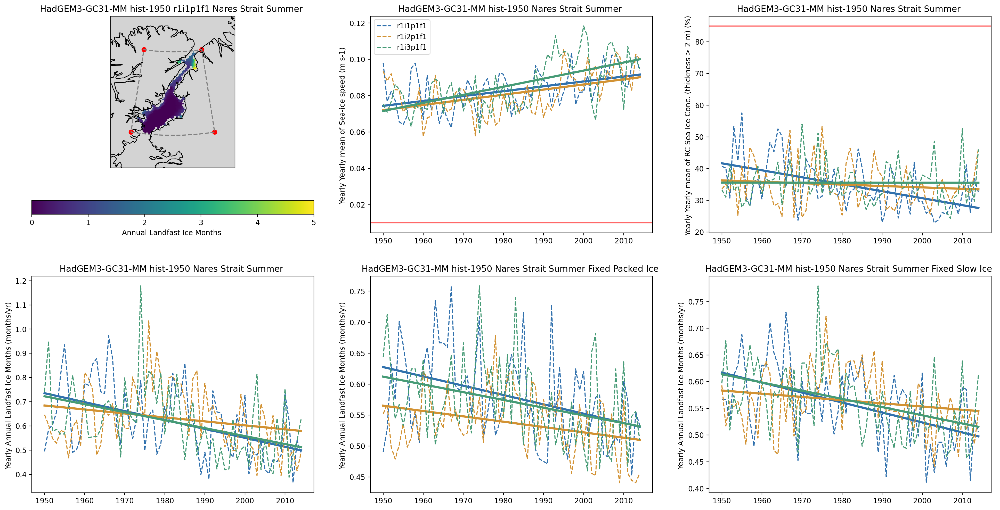